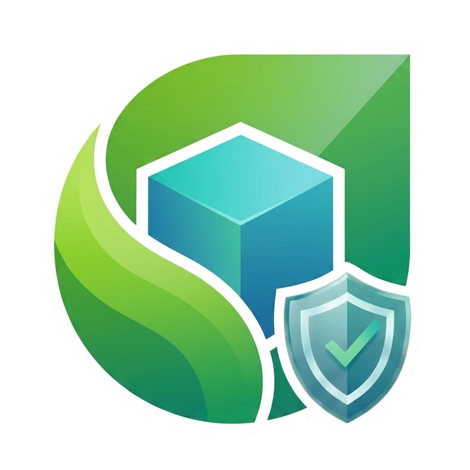

<p align="center">
  
</p>

<p align="center">
  <a href="README.md"></a>
</p>

# SSAM
* [쌈](https://en.wikipedia.org/wiki/Ssam)에서 이름을 따왔습니다.
* SSAM은 Automotive 등과 같은 시스템 리소스가 한정적인 Embedded 환경에서 빠른 *Container-native* app의 실행과 실행 시점의 지속적인 무결성 보장을 지원하기 위해 개발한 솔루션입니다.
* SSAM은 *OCI Runtime* 표준을 활용하여 Container-native app을 실행합니다.
* SSAM은 Container-native app의 실행환경 구성을 위해 Filesystem image를 활용하는 패키지를 정의합니다.
* SSAM은 embedded Linux 환경을 위해 단순화된 컨테이너 패키지의 정의 및 관리, Container의 실행을 관장합니다.
* SSAM은 `dm-verity`를 통해 Container의 실행 중 무결성 보장을 지원합니다.

## Background
*SDV*(Software-Defined Vehicle)에 의한 소프트웨어 통합이 진행됨에 따라 차량 제어기의 소프트웨어 복잡도가 증가하고 있습니다. 이러한 복잡성에 대응하기 위한 접근 방법 중 하나가 컨테이너 기술의 도입입니다.
그러나 기존 OCI 표준을 준수하는 컨테이너 솔루션들은 제한된 성능과 차량 시스템 고유의 요구사항을 충분히 만족하지 못하여 차량 제어기 환경에서의 사용에는 한계가 있습니다.
이러한 한계를 해결하기 위해 고성능·보안 강화 컨테이너 솔루션으로서 **SSAM** 을 개발하였습니다.

## Design principles
SSAM은 각 컨테이너의 설정을 빌드 시점에 확정합니다. 기존의 OCI 기반 컨테이너 솔루션은 실행 시점에
이미지 레이어와 설정을 해석해 쓰기 가능한 컨테이너 루트를 제공하고 실행 환경 구성 정보를 수집합니다.
이와 달리 SSAM은 빌드 단계에서 단일 파일시스템 이미지의 형태로 사전에 컨테이너 루트를 구성하고,
실행 환경 구성 정보를 *OCI Runtime config* 형태로 작성해 서명합니다. 이는 기존 OCI 기반 컨테이너
솔루션이 제공하는 유연성을 빠른 기동 및 실행 시점 무결성 보장과 맞바꾼 것으로, 다음 세 가지 선택에 기반합니다:

- **Static configuration** — 런타임 설정은 패키지를 빌드할 때 선언·서명되며, 런타임에 바뀌지 않습니다.
- **Continuous runtime integrity** — 파일시스템의 모든 블록을 실행 시점에 읽기마다 검증합니다.
- **Single-file package** — 하나의 서명된 설치 단위입니다.

## Features

- **Container Execution**: *systemd* 를 활용해 OCI 호환 container runtime (`crun`)으로 container-native 앱을 실행합니다.
- **Continuous Integrity Verification**: Linux의 `dm-verity`로 패키지 파일시스템을 실행 시점에 읽기마다 검증합니다.
- **Package Management**: 서명된 패키지의 검증, 설치, 제거, 업그레이드를 지원합니다.
- **Resource Isolation**: *OCI Runtime* 이 제공하는 리소스 격리에 더해, 복수의 container-native 앱이 공용으로 사용하는 데이터 영역에 대해 *ext4* 파일 시스템의 project quota 설정을 지원합니다.

## Key Components

* [`ssamd`](ssamd): SSAM 패키지 관리, Container 실행환경 구성 및 실행을 담당하는 데몬.
* [`ssam-wrap`](ssam-wrap): Docker (및 OCI) 이미지 변환 기능을 포함하는 SSAM 패키지 생성도구.
* [`ssam`](ssam): `ssamd`와 gRPC를 통해 통신하는 Command-line interface.

## Requirements

### Build requirements
- Rust 1.99.0+ (2024 edition)

### `ssamd` requirements
- *OCI Runtime*: [`crun`](https://github.com/containers/crun)과 테스트되었습니다.
- 다음과 관련된 Linux 커널 설정 (필수):
  * dm-verity
  * container
  * erofs
- 다음과 관련된 Linux 커널 설정 (선택적):
  * ext4 project quota
  * Bridge networking (`bridge`/`veth`/network namespaces)

### `ssam-wrap` requirements
- `lz4`
- `erofs-utils`
- `fakeroot`
- [`cryptsetup`](https://gitlab.com/cryptsetup/cryptsetup)
- Docker 이미지 변환 기능 사용 시
  - [`umoci`](https://github.com/opencontainers/umoci)
  - [`skopeo`](https://github.com/containers/skopeo) >= 1.15

## Quick start

### 1. Build & Install

`ssam` 저장소를 체크아웃한 루트 디렉터리에서 아래 명령을 실행하세요:

```console
$ SSAM_REPO=$(pwd)   # 저장소 루트를 기억해둠 — 이후 단계에서 디렉터리를 이동함
$ cargo install --path ssam-wrap
$ cargo install --path ssam
$ cargo install --path ssamd
```

`ssam-wrap`, `ssam`, `ssamd`가 `~/.cargo/bin`에 설치됩니다.

### 2. Generate a signing key pair

모든 패키지는 *RSA* 개인 키로 서명되며, `ssamd`가 짝이 되는 공개 키로 검증합니다.

```console
$ mkdir -p ~/ssam/keys && cd ~/ssam/keys
$ openssl genpkey -algorithm RSA -out private_key.pem -pkeyopt rsa_keygen_bits:2048
$ openssl rsa -in private_key.pem -pubout -out public_key.pem
```

### 3. Create packages

컨테이너 이미지를 변환하거나 처음부터 빌드하는 두 가지 방식으로 패키지 파일시스템을 채울 수 있습니다.

**Docker 이미지 변환**

Docker의 `hello-world` 이미지를 활용하는 예시입니다.
`ssam-wrap`은 기본적으로 `arm64` 이미지를 사용합니다 — x86-64 개발 머신이라면 [`--src-oci-arch amd64`](docs/reference/ssam-wrap.ko.md#options)를 설정하세요.

```console
$ mkdir -p ~/ssam/{builtin,downloaded,oci-bundle,data}
$ mkdir -p ~/ssam/docker-helloworld && cd ~/ssam/docker-helloworld
$ ssam-wrap --prepare docker-helloworld --pkgfs-src docker://docker.io/hello-world:latest .
```

prepare 모드는 [`mac`](docs/reference/package-config.ko.md#mac)을 켠 상태로 패키지 설정 — [`config.toml`](docs/reference/package-config.ko.md)을 생성하지만
이는 호스트 시스템에 대응하는 *AppArmor* 프로파일이 로드되어 있어야 동작하므로, 이 샘플에서는 꺼줍니다.

```diff
 [container.security]
 seccomp = true # default is true
-mac = true # default is true
+mac = false # default is true
```

Docker 이미지로부터 생성된 패키지 파일시스템도 필요하면 수정한 뒤 패키지를 빌드합니다.

```console
$ mkdir -p pkgfs/etc
$ cp /etc/resolv.conf pkgfs/etc/
$ ssam-wrap --private-key ~/ssam/keys/private_key.pem --output docker-helloworld.ssam .
$ cp docker-helloworld.ssam ~/ssam/builtin/
```

**처음부터 빌드**

[`--pkgfs-src`](docs/reference/ssam-wrap.ko.md#options) 없이 실행하면 `ssam-wrap`은 비어있는 `pkgfs/`를 생성하므로 필요에 따라 직접 채워줍니다.
여기서는 편의를 위해 정적으로 빌드된 바이너리를 사용합니다.

```console
$ cd ~/ssam
$ ssam-wrap --prepare helloworld helloworld/
$ cd helloworld
$ cargo new --name helloworld app/
$ cargo build --manifest-path app/Cargo.toml --target x86_64-unknown-linux-musl --release
$ cp app/target/x86_64-unknown-linux-musl/release/helloworld pkgfs/
```

패키지 설정에서 `mac`을 꺼줍니다:

```diff
 [container.security]
 seccomp = true # default is true
-mac = true # default is true
+mac = false # default is true
```

템플릿으로 생성된 `runtime.json`의 entrypoint가 실행 바이너리를 가리키도록 수정합니다.

```diff
     "args": [
-      "sh"
+      "/helloworld"
     ],
```

패키지를 빌드합니다.

```console
$ ssam-wrap --private-key ~/ssam/keys/private_key.pem --output helloworld.ssam .
$ cp helloworld.ssam ~/ssam/builtin/
```

> 📖 패키지 생성에 대한 자세한 사항은 [SSAM 패키지 만들기](docs/guides/wrapping-a-ssam.ko.md)를 참고해 주세요.

### 4. Configure and start the daemon

SSAM 데몬 실행파일 — `ssamd`는 동일한 위치에 존재하는 설정파일 — `ssamd.toml`을 읽어들여서 동작합니다.
그러므로 데몬 실행파일이 존재하는 위치에 설정파일 생성도구를 활용하여 파일을 생성한 뒤 root 권한으로 실행합니다.

```console
$ "$SSAM_REPO"/ssamd/releasedata/gen_ssamd_conf.sh \
      --output-path ~/.cargo/bin \
      --builtin-pkgs-dir ~/ssam/builtin \
      --downloaded-pkgs-dir ~/ssam/downloaded \
      --oci-bundle-dir ~/ssam/oci-bundle \
      --pkgs-data-root ~/ssam/data \
      --public-key-file ~/ssam/keys/public_key.pem
$ sudo ~/.cargo/bin/ssamd
[INFO] Successfully loaded runtime configuration from '~/.cargo/bin/ssamd.toml'
```

> 📖 데몬 설정과 실행에 대한 자세한 정보는 [SSAM 실행하기](docs/guides/serving-ssam.ko.md)와 [`ssamd.toml` 레퍼런스](docs/reference/daemon-config.ko.md)에서 다룹니다.

### 5. Verify

데몬이 실행 중인 상태에서 `ssam CLI` 명령을 통해 패키지의 상태를 확인합니다.

```console
$ ssam list
List of packages
Package name         Location      Status
=============================================================
docker-helloworld    builtin       Ready
helloworld           builtin       Ready
```

패키지는 *systemd* 서비스로서 실행되므로 `journalctl`을 활용하여 로그를 확인합니다.

```console
$ journalctl --no-pager -u docker-helloworld
systemd[1]: Started A short description of the package.
crun[]: Hello from Docker!
crun[]: This message shows that your installation appears to be working correctly.
crun[]: To generate this message, Docker took the following steps:
crun[]:  1. The Docker client contacted the Docker daemon.
crun[]:  2. The Docker daemon pulled the "hello-world" image from the Docker Hub.
crun[]:     (amd64)
crun[]:  3. The Docker daemon created a new container from that image which runs the
crun[]:     executable that produces the output you are currently reading.
crun[]:  4. The Docker daemon streamed that output to the Docker client, which sent it
crun[]:     to your terminal.
crun[]: To try something more ambitious, you can run an Ubuntu container with:
crun[]:  $ docker run -it ubuntu bash
crun[]: Share images, automate workflows, and more with a free Docker ID:
crun[]:  https://hub.docker.com/
crun[]: For more examples and ideas, visit:
crun[]:  https://docs.docker.com/get-started/
systemd[1]: docker-helloworld.service: Deactivated successfully.

$ journalctl --no-pager -u helloworld
systemd[1]: Started A short description of the package.
crun[]: Hello, world!
systemd[1]: helloworld.service: Deactivated successfully.
```

> 📖 `ssam CLI`의 사용 방법은 [`ssam` CLI 레퍼런스](docs/reference/ssam.ko.md)를 참고해 주세요.

## Documentation

**Architecture**

- [아키텍처 개요](docs/architecture/overview.ko.md)
- [실행 아키텍처](docs/architecture/execution.ko.md)
- [패키지 관리](docs/architecture/package-management.ko.md)
- [패키지 무결성](docs/architecture/package-integrity.ko.md)
- [컨테이너 격리](docs/architecture/container-isolation.ko.md)
- [SSAM 패키지 포맷](docs/architecture/package-format.ko.md)

**Guides**

- [SSAM 패키지 만들기](docs/guides/wrapping-a-ssam.ko.md) — 패키지 생성
- [패키지 무결성](docs/guides/package-integrity.ko.md) — 서명, dm-verity, 읽기 전용 fs
- [컨테이너 강화](docs/guides/container-hardening.ko.md) — seccomp, AppArmor
- [컨테이너 격리](docs/guides/container-isolation.ko.md) — 네트워크, cgroup, 쿼터
- [SSAM 실행하기](docs/guides/serving-ssam.ko.md) — 데몬 실행
- [Remocon 클라이언트 작성](docs/guides/writing-a-remocon-client.ko.md) — 커스텀 Remocon 클라이언트

**Reference**

- [`config.toml` — 패키지 설정](docs/reference/package-config.ko.md)
- [`ssam-wrap` 명령어 레퍼런스](docs/reference/ssam-wrap.ko.md)
- [`ssamd.toml` — 데몬 설정](docs/reference/daemon-config.ko.md)
- [gRPC 원격 제어 API](docs/reference/remocon-rpc.ko.md)
- [`ssam` CLI 레퍼런스](docs/reference/ssam.ko.md)

## License

Apache License 2.0 - See [LICENSE](LICENSE) for details.

Copyright 2025-2026 Hyundai Mobis Co., Ltd.
