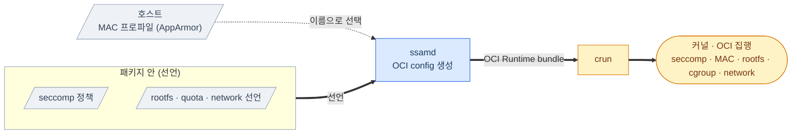

# SSAM Container Isolation

  

실행 중인 컨테이너의 보안 격리 — 시스템 콜 필터링, 강제 접근 제어, 파일시스템/자원 제한, 네트워크 격리 — 는 **OCI Runtime(`crun`)과 Linux 커널** 이 제공합니다.
이 문서는 그 격리 설정을 SSAM이 어떻게 **구성해 *OCI Runtime*에 전달** 하는지를 설명합니다.

---

## Table of Contents

1. [The delegation mechanism](#the-delegation-mechanism)
2. [What is delegated](#what-is-delegated)
3. [Design notes](#design-notes)

---

## The delegation mechanism

격리 설정의 선언은 모두 **패키지 안** 에 있습니다 — `config.toml`, `seccomp.json`, `runtime.json`.
로드 시점에 `ssamd`가 이들로 컨테이너의 단일 **OCI Runtime config를 생성** 한 뒤, 그 번들을 `crun`에 넘깁니다 ([실행 아키텍처](execution.ko.md#the-execution-pipeline) 참조).

경계는 분명합니다: **SSAM은 선언에서 config를 생성** 하고, 실제 격리는 **커널과 `crun`** 이 집행합니다.

---

## What is delegated

각 격리마다 SSAM이 무엇을 하고 누가 집행하는지:

| 격리 | SSAM이 하는 일 | 집행 |
| --- | --- | --- |
| **seccomp** (시스템 콜 필터) | 패키지의 seccomp 정책을 OCI config에 주입 | 커널 |
| **MAC** (강제 접근 제어) | MAC 프로파일을 선택해 OCI config에 설정 (**AppArmor**) | `crun` · 커널 |
| **읽기 전용 rootfs** | OCI root를 읽기 전용으로 설정하고, 선언된 데이터 경로만 bind 마운트 | 커널 |
| **cgroups** | 컨테이너의 cgroup 배치를 설정 | `crun` · 커널 |
| **데이터 쿼터** | 데이터 영역에 파일시스템 쿼터를 설정 | ext4 |
| **네트워크** | 선택된 모드로 network namespace를 구성 | 커널 |

> 📖 설정 *방법* 은 가이드([Container Isolation](../guides/container-isolation.ko.md), [Container Hardening](../guides/container-hardening.ko.md), [Package Integrity](../guides/package-integrity.ko.md))를 참고하세요.

---

## Design notes

표에 담기지 않는 위임 방식의 설계적 특이점:

- **MAC 프로파일은 호스트 시스템에서 나옵니다** — 프로파일을 정의해 커널에 로드하는 것은 호스트의 몫이고, SSAM은 로드된 프로파일을 이름으로 *선택* 해 OCI config에 실을 뿐입니다.
  정책을 패키지가 담는 *seccomp* 과 대조되는 지점입니다.
- **`bridge` 모드는 격리된 내부 브리지** 입니다 — 게이트웨이·NAT·외부 라우팅이 없습니다.
- **읽기 전용 rootfs는 무결성도 뒷받침** 합니다 — 컨테이너가 자신의 패키지 파일시스템을 다시 쓸 수 없습니다 ([Package Integrity](package-integrity.ko.md#filesystem-integrity--dm-verity) 참조).

---

> 📖 이 모든 것 아래에 놓인 무결성 보장 — SSAM이 실제로 구현하는 부분 — 은 [Package Integrity](package-integrity.ko.md)를 참고하세요.
