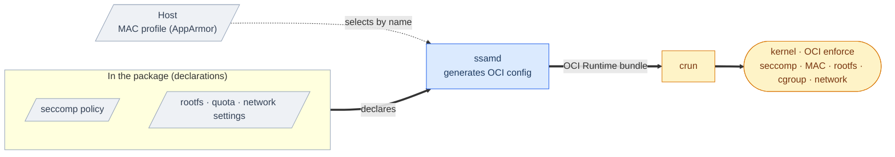

# SSAM Container Isolation

  

A running container's security isolation — syscall filtering, mandatory access
control, filesystem/resource limits, and network isolation — is provided by the
**OCI Runtime (`crun`) and the Linux kernel**. This document describes how SSAM
assembles those isolation settings and delivers them to the *OCI Runtime*.

---

## Table of Contents

1. [The delegation mechanism](#the-delegation-mechanism)
2. [What is delegated](#what-is-delegated)
3. [Design notes](#design-notes)

---

## The delegation mechanism

Every isolation declaration lives **in the package** — `config.toml`,
`seccomp.json`, and `runtime.json`. At load time `ssamd`
generates the container's single **OCI Runtime config** from them, then hands the
bundle to `crun` (see
[Execution Architecture](execution.md#the-execution-pipeline)).

The boundary is clean: **SSAM generates the config from the declarations**, and
the **kernel and `crun` enforce** the isolation.

---

## What is delegated

For each isolation, what SSAM does and who enforces it:

| Isolation | What SSAM does | Enforced by |
| --- | --- | --- |
| **seccomp** (syscall filter) | Injects the package's seccomp policy into the OCI config | kernel |
| **MAC** (mandatory access control) | Selects a MAC profile and sets it in the OCI config (**AppArmor**) | `crun` · kernel |
| **read-only rootfs** | Sets the OCI root read-only and bind-mounts only the declared data paths | kernel |
| **cgroups** | Sets the container's cgroup placement | `crun` · kernel |
| **data quota** | Sets a filesystem quota on the data area | ext4 |
| **network** | Sets up the network namespace for the selected mode | kernel |

> 📖 For *how to configure* these, see the guides ([Container Isolation](../guides/container-isolation.md), [Container Hardening](../guides/container-hardening.md), [Package Integrity](../guides/package-integrity.md)).

---

## Design notes

Design specifics of the delegation that the table doesn't capture:

- **MAC profiles originate on the host** — authoring a profile and
  loading it into the kernel is the host's job; SSAM selects a loaded profile by
  name and sets it in the OCI config. This contrasts with *seccomp*, where the
  package carries the policy.
- **`bridge` mode is an isolated internal bridge** — no gateway, NAT, or external
  routing.
- **The read-only rootfs also underpins integrity** — the container cannot
  rewrite its own package filesystem (see
  [Package Integrity](package-integrity.md#filesystem-integrity--dm-verity)).

---

> 📖 For the integrity guarantees that sit underneath all of this — the part SSAM does implement — see [Package Integrity](package-integrity.md).
