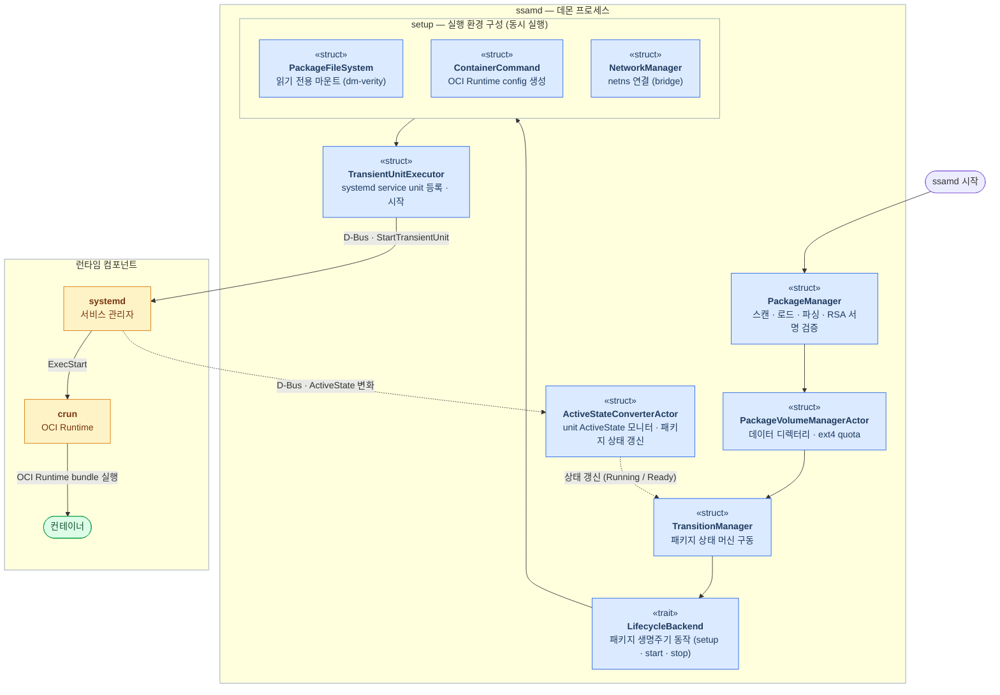
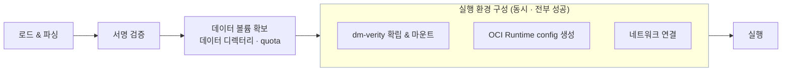
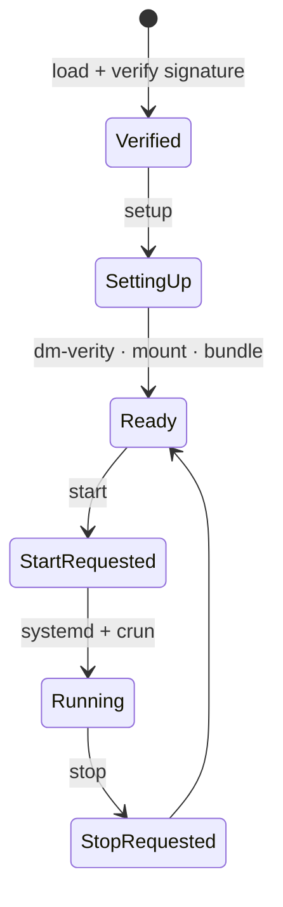

# SSAM 실행 아키텍처

  

`ssamd`가 검증된 SSAM 패키지를 실행 중인 컨테이너로 만드는 과정과 그 구성 요소를 다룹니다.

---

## Table of Contents

1. [Architecture diagram](#architecture-diagram)
2. [The execution pipeline](#the-execution-pipeline)
3. [Running the container](#running-the-container)
4. [Package state machine](#package-state-machine)

---

## Architecture diagram

`ssamd`는 패키지를 로드·검증해 상태 머신으로 관리하고, 컨테이너의 *OCI Runtime bundle* 과 실행 환경을 구성해 실제 실행 요청에 이르기까지를 관장합니다.

- **패키지 관리.** `PackageManager`가 builtin·downloaded 패키지 디렉터리를 스캔·로드하고 서명을 검증하며, 각 패키지의 상태 머신(`TransitionManager`)을 구동합니다.
- **데이터 볼륨 확보.** `PackageVolumeManagerActor`가 패키지가 로드·등록될 때 패키지의 데이터 디렉터리를 만들고, 설정된 경우 데이터 사용량을 제한합니다.
  이 제한은 데이터 파티션의 파일시스템이 *ext4* 일 때만 지원되며, project quota 를 활용해 설정됩니다.
- **실행 환경 구성.** `LifecycleBackend`가 검증된 패키지로부터 컨테이너의 실행 환경을 구성합니다 — `PackageFileSystem`이 파일시스템에 *dm-verity* 를 걸어 실행 시점 무결성을 보장하고 읽기 전용으로 마운트하고, `ContainerCommand`가 *OCI Runtime config* 를 생성하며, `NetworkManager`가 네트워크 네임스페이스를 연결합니다.
- **컨테이너 실행.** `TransientUnitExecutor`가 구성된 *OCI Runtime bundle* 을 *systemd* service unit으로 등록·시작하면, *crun* 이 컨테이너를 생성·실행합니다.
- **컨테이너 상태 추적.** 이후 `ActiveStateConverterActor`가 *systemd* unit의 상태를 모니터해 `TransitionManager`의 패키지 상태(Running / Ready)를 갱신합니다.

---

## The execution pipeline

`ssamd`는 패키지마다 패키지 파일 로드, 실행 환경 구성, 실행이라는 단계를 거칩니다.
실행은 패키지 설정에 자동 시작이 명시되어 있지 않다면 별도의 [`StartPackage`](../reference/remocon-rpc.ko.md#startpackage) 요청이 왔을 때 비로소 컨테이너를 구동합니다.

먼저 패키지를 순서대로 **로드·검증** 합니다:

1. **로드 & 파싱** — SSAM 패키지 파일을 열어 payload 인덱스와 **설정** payload를 읽습니다.
2. **서명 검증** — 패키지의 **설정 데이터** 에 대한 *RSA* PKCS#1 v1.5 서명을 설정된 공개 키로 확인합니다.
   불일치하면 여기서 멈추고 패키지를 `Broken`으로 표시합니다.

검증되면 `ssamd`는 먼저 패키지의 **데이터 볼륨을 확보** 합니다 — [`package.dir.data`](../reference/daemon-config.ko.md#data) 아래에 패키지별 디렉터리를 만들고, 패키지가 [`data_dirs`](../reference/package-config.ko.md#data_dirs)로 선언한 각 경로를 그 안에 생성하며, [`storage_limit`](../reference/package-config.ko.md#storage_limit)이 있으면 *ext4* project quota 로 용량을 제한합니다.

이어서 **실행 환경을 구성** 합니다.
이 구성 작업들은 가능한 경우 **동시에 실행되며, 전부 성공해야 합니다**:

- **dm-verity 확립 & 읽기 전용 마운트** — **서명된 dm-verity 테이블** 로 패키지 파일시스템 이미지에 device-mapper verity 타깃을 설정하고, `package.dir.oci_bundle/<name>_<version>/pkgfs` 아래에 읽기 전용으로 마운트합니다.
  이후 읽기마다 모든 블록이 검증됩니다.
- **OCI Runtime config 생성** — 패키지의 `runtime.json`과 다음 정보를 조합하여 최종 *OCI Runtime config* 로 변환합니다:
  - rootfs 위치
  - 확보한 데이터 디렉터리를 `data_dirs` 경로에 bind mount
  - seccomp 정책
  - cgroup 배치
  - AppArmor 격리
- **네트워크 연결** — `bridge` 모드라면 컨테이너의 network namespace를 내부 브리지에 연결합니다.

마지막으로, rootfs 위치를 포함해 구성된 *OCI Runtime config*, 즉 *OCI Runtime bundle* 을 *systemd* service unit으로 넘겨 컨테이너를 실행합니다(다음 절).

---

## Running the container

`ssamd`는 컨테이너를 *systemd* `transient` service unit으로 실행합니다:

- **systemd.** `ssamd`는 패키지의 [`service_type`](../reference/package-config.ko.md#service_type)에서 `Type=`이 결정되는 **service unit** 을 등록합니다(`simple`, `notify`, `oneshot`, …).
  *systemd* 가 unit의 생명주기·재시작·순서를 소유합니다.
- **`crun`.** *systemd* 의 `ExecStart`가 *OCI Runtime bundle* 을 *crun* 으로 실행하여 컨테이너를 생성합니다.
- **상태 추적 & 로그.** 컨테이너는 *systemd* service로 동작하고, `ssamd`는 그 서비스를 모니터하도록 등록해 둡니다.
  서비스(=컨테이너)의 상태 변화는 `ssamd`로 보고되고, *systemd*·컨테이너가 남기는 로그는 *systemd* journal에 기록되어 `journalctl`로 확인할 수 있습니다.

`ssamd`는 컨테이너 엔진을 내장하지 않고, 타깃의 기존 서비스 관리자(*systemd*)와 *OCI Runtime*(*crun*)을 활용해 컨테이너를 실행합니다.

---

## Package state machine

각 패키지는 `TransitionManager`가 구동하는 생명주기 상태 머신으로 관리됩니다.
패키지별 현재 상태는 [`ListPackages`](../reference/remocon-rpc.ko.md#listpackages) RPC (혹은 `ssam list`)로 조회할 수 있습니다.

| 상태 | 의미 |
| --- | --- |
| `Verified` | 서명 확인됨; 신뢰되지만 아직 셋업 전. |
| `SettingUp` | dm-verity / 마운트 / 프로비저닝 진행 중. |
| `Ready` | 셋업·설치됨; 현재 실행 중 아님. |
| `StartRequested` | [`StartPackage`](../reference/remocon-rpc.ko.md#startpackage) 수락됨; 컨테이너 기동 중. |
| `Running` | 컨테이너 활성 (하위 *systemd* service 상태를 담음). |
| `StopRequested` | [`StopPackage`](../reference/remocon-rpc.ko.md#stoppackage) 수락됨; 컨테이너 종료 중. |
| `CleaningUp` / `Cleaned` | 마운트/자원 해체 진행 중 / 완료. |
| `Upgrading` | 패키지가 새 버전으로 교체되는 중. |
| `Broken` | 패키지는 있으나 사용 불가 (예: 검증 실패). |
| `Error` | 작업 실패. |

새 패키지에서 실행 중인 컨테이너까지의 대표적인 성공 경로:

검증 실패는 `Broken`으로 기록되고, 구성(setup) 실패나 그 외 작업 실패는 `Error`로 이어집니다.
