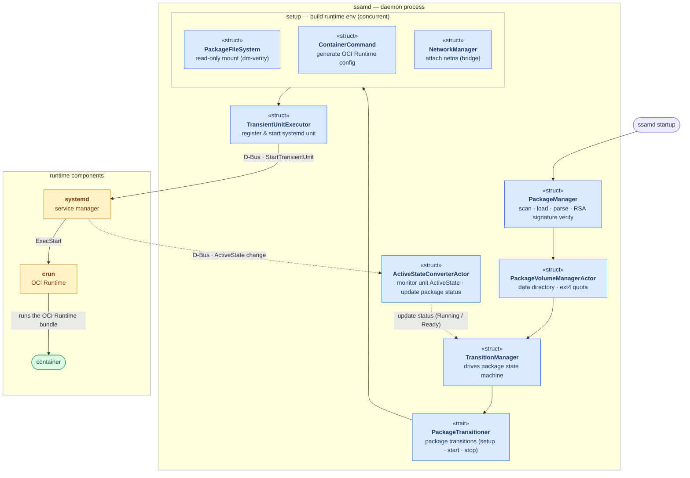
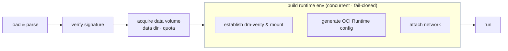
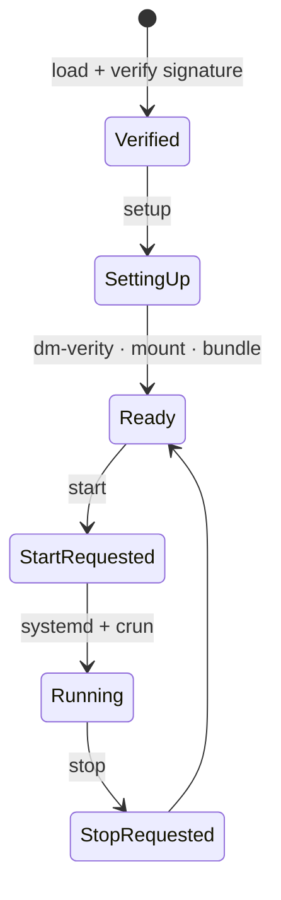

# SSAM Execution Architecture

  

How `ssamd` turns a verified SSAM package into a running container, and the
components involved.

---

## Table of Contents

1. [Architecture diagram](#architecture-diagram)
2. [The execution pipeline](#the-execution-pipeline)
3. [Running the container](#running-the-container)
4. [Package state machine](#package-state-machine)

---

## Architecture diagram

`ssamd` is a long-running root daemon that loads and verifies packages, manages
them through a state machine, and builds each container's *OCI Runtime bundle* and
runtime environment through to the execution request. Below are the components and the flow.

- **Package management.** `PackageManager` scans and loads the bundled and downloaded package
  directories, verifies signatures, and drives each package's state machine (`TransitionManager`).
- **Acquiring the data volume.** `PackageVolumeManagerActor` creates the package's data directory when
  the package is loaded and registered, and — when configured — limits data usage. This limit is
  currently supported only when the data partition's filesystem is *ext4*, applied through *Project Quota*.
- **Building the runtime environment.** `PackageTransitioner` builds the container's
  runtime environment from a verified package — `PackageFileSystem` enables *dm-verity* on the
  filesystem for runtime integrity and mounts it read-only, `ContainerCommand` generates the
  *OCI Runtime config*, and `NetworkManager` attaches the network namespace.
- **Running the container.** `TransientUnitExecutor` registers and starts the assembled
  *OCI Runtime bundle* as a systemd service unit, and *crun* creates and runs the container.
- **Tracking container state.** `ActiveStateConverterActor` then monitors the systemd
  unit's state and updates the package status (Running / Ready) in `TransitionManager`.

---

## The execution pipeline

`ssamd` takes each package through loading the package file, building its
runtime environment, and running it. Running launches the container only when
a separate [`StartPackage`](../reference/remocon-rpc.md#startpackage) request arrives, unless the package config specifies autostart.

First it **loads and verifies** the package, in order:

1. **Load & parse** — open the SSAM package file and read its payload index and its
   **configuration** payloads.
2. **Verify signature** — check the *RSA* PKCS#1 v1.5 signature over the
   package's **configuration data** against the configured public key. A
   mismatch stops here and marks the package `Broken`.

Once verified, it **acquires the package's data volume** — its data directory and
*ext4* Project Quota — then **builds the runtime environment**. These build steps
run **concurrently wherever possible, and all must succeed (fail-closed)**:

- **Establish dm-verity & mount read-only** — from the **signed dm-verity
  table**, set up a device-mapper verity target over the package filesystem
  image and mount it read-only under `packages_mnt_root`, so every block is
  verified on read.
- **Generate the OCI Runtime config** — translate the package's `runtime.json`, combined
  with the following, into the final *OCI Runtime config*:
  - rootfs location
  - additional mounts (data directories, etc.)
  - seccomp policy
  - cgroup placement
  - AppArmor confinement
- **Attach network** — for `bridge` mode, attach the container's network
  namespace to an internal bridge.

Finally, the *OCI Runtime config* built with the rootfs location — the *OCI Runtime bundle* —
is handed to a systemd service unit that runs the container (next section).

---

## Running the container

`ssamd` runs the container as a systemd `transient` service unit:

- **systemd.** `ssamd` registers a **service unit** whose `Type=` comes from the
  package's [`service_type`](../reference/package-config.md#service_type)
  (`simple`, `notify`, `oneshot`, …). systemd owns the unit's lifecycle,
  restarts, and ordering.
- **`crun`.** systemd's `ExecStart` runs *crun* on the *OCI Runtime bundle*,
  which creates the container.
- **Tracking & logs.** The container runs as a systemd service, and `ssamd` registers to
  monitor it. State changes of the service (i.e. the container) are reported back to `ssamd`, and
  logs from systemd and the container go to the systemd journal, viewable with `journalctl`.

Rather than embedding a container engine, `ssamd` uses the target's existing service
manager (systemd) and the *OCI Runtime* (crun) to run the container.

---

## Package state machine

`TransitionManager` drives each package's lifecycle state machine.
The current state per package can be queried via the [`ListPackagesStatus`](../reference/remocon-rpc.md#listpackagesstatus) RPC (or `ssam list`).

| State | Meaning |
| --- | --- |
| `Verified` | Signature checked; package is trusted but not yet set up. |
| `SettingUp` | dm-verity / mount / provisioning in progress. |
| `Ready` | Set up and installed; not currently running. |
| `StartRequested` | [`StartPackage`](../reference/remocon-rpc.md#startpackage) accepted; container coming up. |
| `Running` | Container active (carries the underlying systemd service state). |
| `StopRequested` | [`StopPackage`](../reference/remocon-rpc.md#stoppackage) accepted; container coming down. |
| `CleaningUp` / `Cleaned` | Teardown of mounts / resources in progress / done. |
| `Upgrading` | Package is being replaced by a newer version. |
| `Broken` | Package present but unusable (e.g. failed verification). |
| `Error` | An operation failed. |

The typical happy path from a fresh package to a running container:

Verification failures are recorded as `Broken`; setup failures and other
failed operations surface as `Error`.
