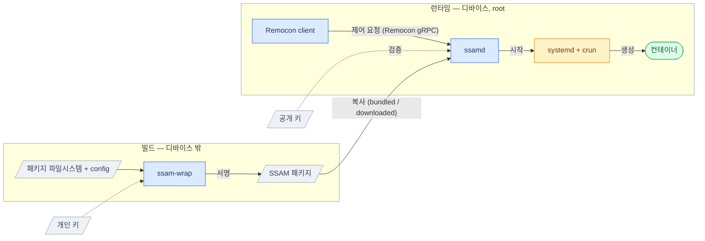

# SSAM 아키텍처 개요

  

**SSAM** 은 차량용 시스템과 같이 자원이 제한된 임베디드 시스템에서 *container-native* 애플리케이션
실행에 필요한 환경 설정부터, *OCI Runtime* 을 활용한 실제 실행까지 수행하는 종합 솔루션입니다.

높은 유연성과 자유도를 전제로 범용 애플리케이션을 구동하는 기존 OCI 스택 구현은,
특수 목적용 애플리케이션이 동작하고 무결성이 보안·안전에 직결되는 임베디드 시스템에는
상대적으로 무겁고, 무결성을 고려하지도 않습니다.

SSAM은 이러한 특수 목적용 임베디드 시스템을 위해, 정적 configuration을 최대한 활용해
상대적으로 덜 중요한 다양성·유연성을 희생하는 대신 더 중요한 **무결성 보장** 및
**빠른 기동** 을 지향하도록 설계되었습니다.

이 문서에서는 이러한 목적을 위해 SSAM 구현에 적용된 구조를 설명합니다.

---

## Table of Contents

1. [Components](#components)
2. [System overview](#system-overview)
3. [Lifecycle of a package](#lifecycle-of-a-package)
4. [Package management](#package-management)
5. [Static configuration](#static-configuration)
6. [Runtime architecture](#runtime-architecture)
7. [Security model — defense in depth](#security-model--defense-in-depth)
8. [Container isolation](#container-isolation)

---

## Components

| 컴포넌트 | 역할 | 구분 |
| --- | --- | --- |
| **`ssam-wrap`** | 서명·무결성 보호되는 `SSAM` 패키지 생성 도구. | Build |
| **`ssamd`** | 패키지를 설치·검증·구성해 컨테이너로 실행하는, root 권한으로 동작하는 데몬; 제어 RPC를 노출. | Runtime |
| **`ssam`** | RPC로 `ssamd`를 조작하는 CLI 클라이언트 (list / install / start / stop / remove). | Control |

---

## System overview

SSAM은 (디바이스 밖에서 패키지를 생성하는) **빌드** 와 (디바이스에서
검증·실행하는) **런타임** 을 분리하고, 서명된 `SSAM 패키지` 산출물로 이 둘을
연결합니다:

- 개인 키는 패키지 생성 시 서명하고, 짝이 되는 공개 키는 로드 시점 검증에 사용합니다.
- `SSAM` 패키지가 자체적으로 실행에 필요한 정보를 모두 담고 있어, 별도의 manifest 같은 추가 정보가 필요 없습니다.

---

## Lifecycle of a package

패키지 작성에서 컨테이너 실행까지:

1. **작성** — 패키지를 구성하는 `파일시스템`과 *OCI Runtime config* 를 포함하여 실행 환경에 필요한 각종 `설정`을 준비.
   → [SSAM 만들기](../guides/wrapping-a-ssam.ko.md)
2. **생성** — 패키지 생성도구 `ssam-wrap`을 사용하여 준비된 구성 요소를 기반으로 서명된 `SSAM 패키지` 생성.
   → [패키지 포맷](package-format.ko.md)
3. **배포** — SSAM 패키지를 데몬의 패키지 디렉터리에 위치.
4. **로드 & 검증** — `ssamd`가 패키지를 읽고 설정된 공개 키로 서명을 검증.
5. **실행환경 구성** — 패키지에 포함된 파일시스템과 *OCI Runtime config* 등의 설정을 기반으로 컨테이너의 실행 환경 구성 및 *OCI Runtime bundle* 을 준비
6. **실행** — 구성된 실행 환경 위에서 *OCI Runtime* 으로 *OCI Runtime bundle* 을 실행하여 컨테이너를 생성.
   → [SSAM 실행하기](../guides/serving-ssam.ko.md)
7. **관리** — `ssam` 등의 Remocon 클라이언트로 패키지 관리 - 설치·업그레이드·시작·중지·제거.
   → [Remocon 클라이언트 작성](../guides/writing-a-remocon-client.ko.md)

---

## Package management

디바이스의 패키지는 두 소스에서 옵니다:
- **bundled**: 디바이스 이미지에 사전 탑재 (읽기 전용)
- **downloaded**: 런타임에 제어 API로 설치

`ssamd`는 요청에 따라 이들을 설치·업데이트·제거하며, 같은 이름이면 downloaded가 bundled를 덮어쓰고,
그 override를 제거하면 아래의 bundled 패키지가 복원됩니다.

> 📖 상세는 [Package Management](package-management.ko.md)를 참고하세요.

---

## Static configuration

SSAM은 패키지 실행에 필요한 설정 정보를 실행 시점에 동적으로 구성하지 않고, 패키지 작성 및 생성 단계에서
준비하여 사전에 고정하는 **정적**(static) 구성을 지향합니다.
이는 크게 다음의 두 가지 형태로 적용됩니다:

- **파일시스템** — 컨테이너 파일시스템은 단일 사전빌드 이미지 그대로 마운트되는 형태로, 런타임에
  overlay로 합성되는 레이어 스택이 아닙니다. 이는 **빠른 기동** 을 달성하는 핵심 요소입니다.
- **설정** — *OCI Runtime config* 를 포함하여, 실행 환경을 구성하는 정보는 빌드 시점에 작성하길
  요구하며, 실행 시점에 `ssamd`가 패키지를 로드할 때 포함된 config로부터 디바이스에 따라 달라지는
  고유 설정사항 (e.g. 마운트 소스, cgroup 배치)만 채워서 최종 config를 생성합니다.
  실행 설정 대부분이 빌드 단계에서 고정되므로 **서명·검증** 할 수 있습니다.

---

## Runtime architecture

런타임에 `ssamd`의 주된 역할은 *OCI Runtime* 이 컨테이너를 실행할 수 있도록 실행
환경을 구성하는 것입니다. `ssamd`는 각 패키지를 추적·검증한 뒤, 검증된 패키지로부터
컨테이너의 *OCI Runtime config* 를 생성하고, 파일시스템·자원·네트워크 등의 실행 환경을
구성하여 **OCI Runtime spec과 호환** 되는 *OCI Runtime bundle* 을 만듭니다.
그러므로 어떤 *OCI Runtime* 으로도 실행할 수 있습니다.

`ssamd`는 이 번들로 컨테이너를 실행하기 위해 *crun* 을 사용하며, *systemd transient service unit*
형태로 구성하여 컨테이너를 실제로 실행합니다. 이후 `ssamd`는 실행된 컨테이너의 상태를 모니터링하며
패키지 상태를 관리합니다.

> 📖 상세는 [SSAM 실행 아키텍처](execution.ko.md)를 참고하세요.

---

## Security model — defense in depth

SSAM은 주요 기능으로서 **패키지 무결성** 을 보장합니다 — 신뢰할 수 있고 변조되지 않은
패키지라면 자유로운 업데이트를 허용하면서도 지속적으로 검증하며 실행합니다:

1. **RSA 서명.** 각 패키지는 **설정 데이터** 에 서명되며, `ssamd`는
   신뢰된 키로 서명되지 않은 것을 거부합니다.
2. **지속적 무결성.** `ssamd`는 *dm-verity* 로 커널이 읽기마다 모든 블록을 검증하게
   하여, 변조를 로드 시점뿐 아니라 런타임에도 감지합니다. *dm-verity* 파라미터가 *RSA* 로
   서명되는 설정 데이터에 포함되므로 이 검증 자체의 신뢰성도 보장됩니다.

> 📖 상세는 [Package Integrity](package-integrity.ko.md)를 참고하세요.

---

## Container isolation

컨테이너 격리(seccomp, MAC (AppArmor), cgroup, 네트워크)는 커널과 *OCI Runtime* 이
제공합니다. SSAM은 패키지가 이 격리를 지정하는 수단을 제공합니다.

> 📖 상세는 [Container Isolation](container-isolation.ko.md)를 참고하세요.
