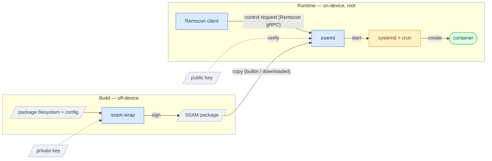

# SSAM Architecture Overview

  

**SSAM** is a comprehensive solution for running *container-native* applications on resource-constrained embedded systems such as automotive systems — covering everything from preparing the environment an application needs to its actual execution on the *OCI Runtime*.

Conventional OCI stack implementations target general-purpose applications running in environments built for high flexibility and freedom; for embedded systems — which run special-purpose applications and where integrity is directly tied to security and safety — they are relatively heavy and do not account for integrity.

For such special-purpose embedded systems, SSAM leans heavily on static configuration, trading away the less-important flexibility and variety for the more-important goals of **integrity** and **fast startup**.

This document describes the architecture SSAM's implementation applies toward those goals.

---

## Table of Contents

1. [Components](#components)
2. [System overview](#system-overview)
3. [Lifecycle of a package](#lifecycle-of-a-package)
4. [Package management](#package-management)
5. [Static configuration](#static-configuration)
6. [Runtime architecture](#runtime-architecture)
7. [Security model — defense in depth](#security-model--defense-in-depth)
8. [Container isolation](#container-isolation)

---

## Components

| Component | Role | Side |
| --- | --- | --- |
| **`ssam-wrap`** | Build-time tool that produces a signed, integrity-protected SSAM package. | Build |
| **`ssamd`** | Root daemon that installs, verifies, sets up, and runs packages as containers; exposes a control RPC. | Runtime |
| **`ssam`** | CLI client that drives `ssamd` over RPC (list / install / start / stop / remove). | Control |

---

## System overview

SSAM separates the **build side** (producing packages off-device) from the **runtime side** (verifying and running them on-device), joined by the signed SSAM package artifact:

- The private key signs when the package is built; the matching public key verifies at load time.
- The SSAM package carries everything needed to run on its own, so no separate manifest-like information is required.

---

## Lifecycle of a package

From authoring to a running container:

1. **Author** — prepare the package's filesystem, its *OCI Runtime config*, and the various settings the runtime environment needs.
   → [Wrapping a SSAM](../guides/wrapping-a-ssam.md)
2. **Wrap** — with the packaging tool `ssam-wrap`, turn those prepared inputs into a signed SSAM package.
   → [Package format](package-format.md)
3. **Deploy** — place the SSAM package in the daemon's packages directory.
4. **Load & verify** — `ssamd` reads the package and verifies its signature against the configured public key.
5. **Build the runtime environment** — from the package's filesystem and *OCI Runtime config*, build the container's runtime environment and prepare the *OCI Runtime bundle*.
6. **Run** — run it as a container with the *OCI Runtime*, using the *OCI Runtime bundle* on the built environment.
   → [Serving SSAM](../guides/serving-ssam.md)
7. **Manage** — install / upgrade / start / stop / remove packages via a Remocon client such as `ssam`.
   → [Writing a Remocon Client](../guides/writing-a-remocon-client.md)

---

## Package management

A device carries packages from two sources:
- **builtin**: pre-loaded in the device image (read-only)
- **downloaded**: installed at runtime through the control API

`ssamd` installs, updates, and removes downloaded packages on request — a downloaded package overrides a builtin one of the same name, and removing that override restores the builtin package underneath.

> 📖 See [Package Management](package-management.md) for details.

---

## Static configuration

Rather than composing the configuration a package needs at runtime on the device, SSAM prepares it during authoring and build, fixing it ahead of time — **static** configuration.
This takes two forms:

- **Filesystem** — the container filesystem is a single prebuilt image, mounted directly, rather than a stack of layers composed by an overlay at runtime.
  This is the key to **fast startup**.
- **Configuration** — the information that composes the runtime environment, including the *OCI Runtime config*, must be authored at build time; at load, `ssamd` fills in only the device-specific settings (mount sources, cgroup placement) from the bundled config to produce the final config.
  Because most runtime settings are fixed at build time, the package can be **signed and verified**.

---

## Runtime architecture

On the runtime side, `ssamd`'s main role is to build the environment an *OCI Runtime* needs to run the container.
From a verified package, `ssamd` tracks and verifies it, generates the container's *OCI Runtime config*, and builds the runtime environment (filesystem, resources, network) into an **OCI Runtime spec-compatible** *OCI Runtime bundle*.
It can therefore be run by any *OCI Runtime*.

`ssamd` uses *crun* to run the container from this bundle, configuring it as a *systemd transient service unit* to actually run it.
`ssamd` then monitors the running container's state and manages the package status.

> 📖 See [Execution Architecture](execution.md) for details.

---

## Security model — defense in depth

SSAM's core guarantee is **package integrity** — a trusted, unmodified package may be updated freely, yet is still verified and run continuously:

1. **RSA signature.** Each package is signed over its **configuration data**; `ssamd` rejects anything not signed by the trusted key.
2. **Continuous integrity.** `ssamd` uses *dm-verity* to have the kernel verify every block on read, so tampering is caught at runtime, not just at load.
   The *dm-verity* parameters are included in the configuration data signed with *RSA*, so the integrity check itself is trustworthy.

> 📖 See [Package Integrity](package-integrity.md) for details.

---

## Container isolation

The isolation that confines a running container (seccomp, MAC (AppArmor), cgroups, and network) is provided by the kernel and the *OCI Runtime*.
SSAM provides the means for a package to **specify** this isolation.

> 📖 See [Container Isolation](container-isolation.md) for details.
