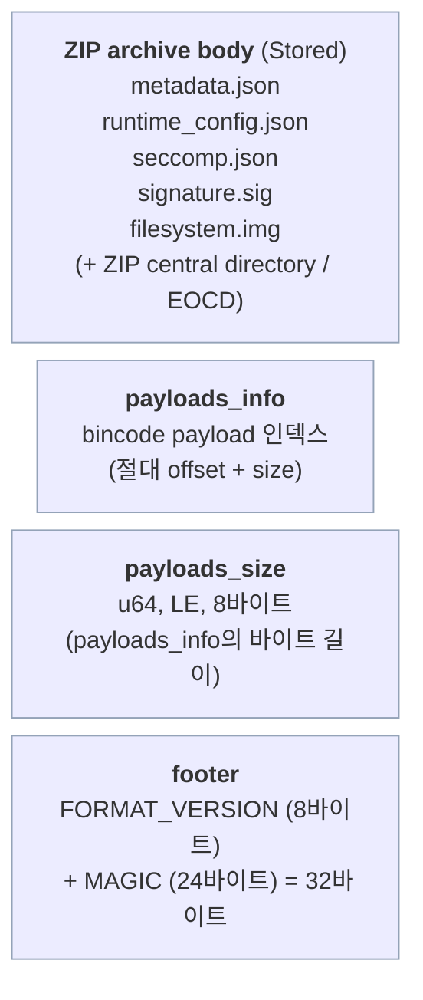

# SSAM 패키지 포맷 명세

<p>
  <a href="package-format.md"></a>
</p>

이 문서는 SSAM 패키지 파일(기본 확장자 `.ssam`)의 **온디스크 바이너리 레이아웃** — 어떤 바이트가
어디에 있고, payload가 어떻게 인덱싱되며, 서명과 무결성 체인이 어떻게
동작하는지 — 를 명세합니다. 패키지를 파싱·검증·재구성하는 도구를 위한 명세입니다.

- **개념적** "패키지 안에 무엇이 들어있나" 개요는
  [SSAM 패키지의 구조](../guides/wrapping-a-ssam.ko.md#anatomy-of-a-ssam-package)를 참고하세요.
- 이 문서는 **포맷 버전 `0.6.0`** 을 기술합니다.

---

## Top-level layout

SSAM 패키지 파일은 **ZIP 아카이브 뒤에 메타데이터 인덱스와 고정 푸터를 덧붙인**
구조입니다. 인덱스와 푸터는 ZIP 자체의 end-of-central-directory 뒤에 붙습니다.
리더는 파일 끝에서부터 seek하여 필요한 정보를 모두 찾습니다:



ZIP 뒤에 덧붙이는 설계 덕분에 SSAM 패키지 파일은 여전히 구조적으로 유효한 ZIP이며
(도구로 엔트리 목록을 볼 수 있음), SSAM 자체 리더는 뒤에 붙은 인덱스와 푸터로
payload를 절대 offset 기준으로 찾아 검증합니다.

---

## 1. ZIP archive body

본문은 **`Stored`(무압축)** 로 기록된 표준 ZIP 아카이브입니다. 따라서 각 엔트리의
바이트가 연속적이며 절대 파일 offset으로 직접 접근 가능합니다 — payload가 offset
으로 읽히고([payloads_info](#2-payloads_info-the-payload-index) 참조) 파일시스템
이미지가 제자리에서 소비되기 때문에 필요합니다.

엔트리는 `PayloadType` 순서로 기록됩니다:

| 엔트리 이름 | Payload | 인코딩 | 서명 다이제스트 포함? |
| --- | --- | --- | --- |
| `metadata.json` | 패키지 메타데이터 | **bincode** (아래 참고) | ✅ 예 |
| `runtime_config.json` | *OCI Runtime* 스펙 | JSON | ✅ 예 |
| `seccomp.json` | seccomp 정책 | JSON | ✅ 예 |
| `signature.sig` | RSA 서명 | 원시 서명 바이트 | — (서명 자체) |
| `filesystem.img` | 패키지 파일시스템 이미지 | EROFS/ext4 이미지 + dm-verity 해시 트리 | ❌ 아니오 (dm-verity로 바인딩 — [무결성](#signature-and-integrity) 참조) |

> **`metadata.json` 에 대한 참고:** `.json` 접미어이지만 바이트는 JSON이
> 아니라 **bincode로 인코딩** 된 `PackageMetadata` 입니다. `runtime_config.json` 과
> `seccomp.json` 은 실제 JSON입니다. 엔트리 이름은 고정 레이블이며 콘텐츠 형식을
> 선언하지 않습니다.

### `metadata` contents (`PackageMetadata`)

bincode로 인코딩된 메타데이터가 담는 것:

| 필드 | 의미 |
| --- | --- |
| `package_config` | 전체 `config.toml` (`PackageConfigSpec`) |
| `build_date` | 빌드 타임스탬프 |
| `pkgfs_type` | 파일시스템 타입 (`erofs`, `ext4`, …) |
| `pkgfs_verity_info` | dm-verity 파라미터 (아래) |

`pkgfs_verity_info`:

| 필드 | 의미 |
| --- | --- |
| `data_size` | 파일시스템 데이터 영역 크기 (바이트) |
| `hash_size` | 덧붙인 dm-verity 해시 트리 크기 (바이트) |
| `table_params` | 서명된 dm-verity 테이블 ([무결성](#signature-and-integrity) 참조) |
| `hash_offset` | 해시 트리가 시작하는 바이트 offset (블록 정렬됨) |

---

## 2. `payloads_info` (the payload index)

ZIP 본문 바로 뒤에는 각 `PayloadType` 을 `Payload::Internal((offset, size))` 로
매핑하는 **bincode 인코딩 인덱스** 가 옵니다 — 해당 엔트리 데이터의 파일 내 **절대
바이트 offset** 과 바이트 길이입니다. offset은 각 ZIP 엔트리의 데이터 시작점을
기준으로 하므로, 리더는 ZIP central directory를 순회하지 않고도 임의의 payload를 직접
읽을 수 있습니다.

인덱스는 `BTreeMap<PayloadType, Option<Payload>>` 이며 SSAM의 bincode 설정으로
직렬화됩니다([Serialization conventions](#serialization-conventions) 참조).

---

## 3. `payloads_size`

직렬화된 `payloads_info` 블록의 바이트 길이를 담는 단일 **`u64`, 리틀 엔디언,
고정 폭(8바이트)** 입니다. `payloads_info` 와 푸터 사이에 위치하여 리더가
`payloads_info` 의 시작 위치를 계산할 수 있게 합니다:

```
payloads_info_offset = file_size − 32 (푸터) − 8 (이 필드) − payloads_size
```

---

## 4. Footer

파일의 마지막 **32바이트** 이며, 순서는 다음과 같습니다:

| 필드 | 길이 | 값 |
| --- | --- | --- |
| `FORMAT_VERSION` | 8바이트 | ASCII `"0.6.0"` NUL 패딩: `0.6.0\0\0\0` |
| `MAGIC` | 24바이트 | ASCII `MIRAEPLATFORMGAEBALGROUP` |

리더는 `MAGIC`(마지막 24바이트)과 `FORMAT_VERSION`(그 앞 8바이트)을 검증합니다.
매직 불일치 또는 인식되지 않는 버전은 payload 파싱 이전에 거부됩니다.

---

## Signature and integrity

### The RSA signature

`signature.sig` 는 **SHA-256 다이제스트에 대한 RSA PKCS#1 v1.5 서명** 입니다.
다이제스트는 검증 대상인 세 payload를 `PayloadType` 순서로 이어붙여 계산합니다:

```
digest = SHA256( metadata_bytes ‖ runtime_config_bytes ‖ seccomp_bytes )
```

`signature.sig` 와 `filesystem.img` 는 다이제스트에 **포함되지 않습니다**. 서명에는
`ssam-wrap` 에 제공된 개인 키를, 검증에는 `ssamd` 에 설정된 공개 키를
사용합니다(`ssamd.toml` 의 `public_key_file_path`).

### How the filesystem image is protected

`filesystem.img` 는 (클 수 있으므로) 의도적으로 RSA 다이제스트에서 제외됩니다.
대신 무결성은 **간접적으로(transitively)** 바인딩됩니다:

1. 파일시스템은 *dm-verity* 로 포맷되며, 머클 트리의 **루트 해시** 가
   `pkgfs_verity_info.table_params` 의 일부입니다.
2. `table_params` 는 `metadata` 안에 있고, `metadata` 는 RSA 서명으로 **보호됩니다**.
3. 런타임에 `ssamd` 는 서명된 `table_params` 로 dm-verity 타깃을 구성하므로,
   `filesystem.img` 를 변조하더라도 읽기 시점에 — 로드 시점만이 아니라 —
   지속적으로 검증에 실패합니다.

따라서 *RSA* 서명은 설정 파일을 직접 보호하고, 파일시스템 이미지는 서명된 dm-verity
루트 해시로 간접적으로 보호합니다.

### Signed dm-verity table (`table_params`)

서명된 테이블은 커널 dm-verity 테이블에서 **두 개의 런타임 디바이스 슬롯**
(`data_dev` / `hash_dev`)을 **제외** 한 것이며, 이 슬롯은 `ssamd` 가 로드 시점에
삽입합니다:

```
version data_block_size hash_block_size data_blocks hash_start_block algorithm root_hash salt
```

두 개의 디바이스 슬롯만 로드 시점에 채워지므로, 나머지 서명된 파라미터 — 블록
크기, 데이터 블록, 알고리즘, **루트 해시**, salt — 는 서명으로 고정되어 런타임에
변경할 수 없습니다.

---

## Reading and verification algorithm

리더는 뒤에서 앞으로 파싱합니다:

1. **푸터:** 마지막 24바이트를 읽어 `MAGIC` 확인; 그 앞 8바이트를 읽어
   `FORMAT_VERSION` 확인.
2. **payloads_size:** `file_size − 32 − 8` 위치의 `u64` 를 읽음.
3. **경계 검사:** `payloads_size > file_size − 32 − 8` 이면 거부.
4. **payloads_info:** `file_size − 32 − 8 − payloads_size` 로 seek하여 payload
   인덱스를 bincode 디코드.
5. **검증:** `signature.sig` 를 읽고, 인덱싱된 offset으로 `metadata` +
   `runtime_config` + `seccomp` 를 읽어 이어붙인 뒤 SHA-256; 공개 키로 RSA 검증.
   불일치 시 거부.
6. **파싱:** 이제 검증된 `metadata`(bincode), `runtime_config`(JSON),
   `seccomp`(JSON)를 역직렬화하여 사용.

---

## Serialization conventions

- **bincode**(`payloads_info`, `payloads_size`, `metadata`)는 SSAM 설정을
  사용합니다: **리틀 엔디언, 고정 정수 인코딩**(따라서 `u64` 는 항상 8바이트),
  적대적인 크기 필드로 인한 검증 전 할당을 제한하기 위한 **디코드 크기 한도
  1 MiB**(`SSAM_MAX_DECODE_SIZE`).
- 검증 중 읽는 각 서명 payload는 **4 MiB** 로 제한됩니다
  (`MAX_VERIFY_PAYLOAD_SIZE`).
- `runtime_config.json` 과 `seccomp.json` 은 UTF-8 JSON입니다.

---

## Constants summary

| 상수 | 값 |
| --- | --- |
| `MAGIC` | `MIRAEPLATFORMGAEBALGROUP` (24바이트, ASCII) |
| `FORMAT_VERSION` | `0.6.0\0\0\0` (8바이트, NUL 패딩 ASCII) |
| 푸터 길이 | 32바이트 |
| `payloads_size` 폭 | `u64`, 리틀 엔디언, 고정 (8바이트) |
| 서명 방식 | RSA PKCS#1 v1.5 + SHA-256 |
| 서명 대상 payload | `metadata`, `runtime_config`, `seccomp` |
| ZIP 압축 | `Stored` (무압축) |
| bincode 디코드 한도 | 1 MiB |
| 서명 payload 읽기 상한 | 4 MiB |

---

이 바이트들이 실제로 어떻게 생성·소비되는지는
[SSAM 만들기 가이드](../guides/wrapping-a-ssam.ko.md)와
[`ssam-wrap` 명령어 레퍼런스](../reference/ssam-wrap.ko.md)를 참고하세요.
