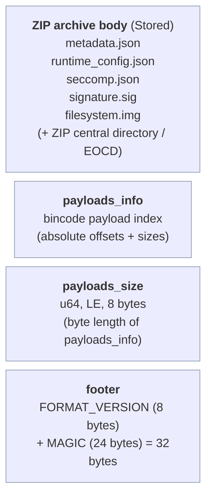

# SSAM Package Format Specification

<p>
  <a href="package-format.ko.md"></a>
</p>

This document specifies the **on-disk binary layout** of a SSAM package file
(default extension `.ssam`) — what bytes live where, how payloads are indexed, and how the signature and
integrity chain work. It is a specification for tooling that parses, verifies, or
reconstructs packages.

- For the **conceptual** "what's inside a package" overview, see
  [The SSAM package](../guides/wrapping-a-ssam.md#the-ssam-package).
- This document describes **format version `0.6.0`**.

---

## Top-level layout

A SSAM package file is a **ZIP archive with a trailing metadata index and a fixed
footer** appended after the ZIP's own end-of-central-directory. Readers locate
everything by seeking from the end of the file:



The append-after-ZIP design means a SSAM package file is still a structurally valid
ZIP (tools can list its entries), while SSAM's own reader uses the trailing
index and footer to find and verify payloads by absolute offset.

---

## 1. ZIP archive body

The body is a standard ZIP archive written with **`Stored` (no compression)**,
so every entry's bytes are contiguous and directly addressable by absolute file
offset — required because payloads are read via offsets (see
[payloads_info](#2-payloads_info-the-payload-index)) and the filesystem image is
consumed in place.

Entries are written in `PayloadType` order:

| Entry name | Payload | Encoding | In signed digest? |
| --- | --- | --- | --- |
| `metadata.json` | Package metadata | **bincode** (see note) | ✅ Yes |
| `runtime_config.json` | *OCI Runtime config* | JSON | ✅ Yes |
| `seccomp.json` | Seccomp policy | JSON | ✅ Yes |
| `signature.sig` | RSA signature | raw signature bytes | — (is the signature) |
| `filesystem.img` | Package filesystem image | EROFS/ext4 image + dm-verity hash tree | ❌ No (bound via dm-verity — see [Integrity](#signature-and-integrity)) |

> **Note on `metadata.json`:** despite the `.json` suffix, the bytes are
> **bincode-encoded** (`PackageMetadata`), not JSON. `runtime_config.json` and
> `seccomp.json` are genuine JSON. The entry names are fixed labels, not content
> declarations.

### `metadata` contents (`PackageMetadata`)

The bincode-encoded metadata carries:

| Field | Meaning |
| --- | --- |
| `package_config` | The full `config.toml` (`PackageConfigSpec`) |
| `build_date` | Build timestamp |
| `pkgfs_type` | Filesystem type (`erofs`, `ext4`, …) |
| `pkgfs_verity_info` | dm-verity parameters (below) |

`pkgfs_verity_info`:

| Field | Meaning |
| --- | --- |
| `data_size` | Size of the filesystem data area (bytes) |
| `hash_size` | Size of the appended dm-verity hash tree (bytes) |
| `table_params` | Signed dm-verity table (see [Integrity](#signature-and-integrity)) |
| `hash_offset` | Byte offset where the hash tree begins (block-aligned) |

---

## 2. `payloads_info` (the payload index)

Immediately after the ZIP body comes a **bincode-encoded index** mapping each
`PayloadType` to a `Payload::Internal((offset, size))` — the **absolute byte
offset** of that entry's data within the file and its length in bytes. Offsets
are taken from each ZIP entry's data start, so the reader can read any payload
directly without walking the ZIP central directory.

The index is a `BTreeMap<PayloadType, Option<Payload>>`, serialized with SSAM's
bincode configuration (see [Serialization conventions](#serialization-conventions)).

---

## 3. `payloads_size`

A single **`u64`, little-endian, fixed-width (8 bytes)** giving the byte length
of the serialized `payloads_info` block. It sits between `payloads_info` and the
footer so a reader can compute where `payloads_info` starts:

```
payloads_info_offset = file_size − 32 (footer) − 8 (this field) − payloads_size
```

---

## 4. Footer

The last **32 bytes** of the file, in this order:

| Field | Length | Value |
| --- | --- | --- |
| `FORMAT_VERSION` | 8 bytes | ASCII `"0.6.0"` NUL-padded: `0.6.0\0\0\0` |
| `MAGIC` | 24 bytes | ASCII `MIRAEPLATFORMGAEBALGROUP` |

A reader validates `MAGIC` (last 24 bytes) and `FORMAT_VERSION` (the 8 bytes
before it). A mismatched magic or an unrecognized version is rejected before any
payload parsing.

---

## Signature and integrity

### The RSA signature

`signature.sig` is an **RSA PKCS#1 v1.5 signature over a SHA-256 digest**. The
digest is computed over the concatenation of the three verify-required payloads,
in `PayloadType` order:

```
digest = SHA256( metadata_bytes ‖ runtime_config_bytes ‖ seccomp_bytes )
```

`signature.sig` and `filesystem.img` are **not** part of the digest. Signing
uses the private key provided to `ssam-wrap`; verification uses the public key
configured in `ssamd` (`public_key_file_path` in `ssamd.toml`).

### How the filesystem image is protected

`filesystem.img` is deliberately excluded from the *RSA* digest (it can be large).
Its integrity is instead bound **transitively**:

1. The filesystem is *dm-verity*-formatted; its *Merkle*-tree **root hash** is part
   of `pkgfs_verity_info.table_params`.
2. `table_params` lives inside `metadata`, which **is** covered by the *RSA*
   signature.
3. At runtime `ssamd` builds the *dm-verity* target from the signed
   `table_params`, so any tampering with `filesystem.img` fails verification on
   read — continuously, not just at load time.

Thus the *RSA* signature protects the configs directly and the filesystem image
indirectly through the signed *dm-verity* table.

### Signed dm-verity table (`table_params`)

The signed table is the kernel *dm-verity* table **minus the two runtime device
slots** (`data_dev` / `hash_dev`), which `ssamd` inserts at load time:

```
version data_block_size hash_block_size data_blocks hash_start_block algorithm root_hash salt
```

Because only those two device slots are supplied at load, every signed
parameter — block sizes, data blocks, algorithm, **root hash**, and salt — is
fixed by the signature and cannot be changed at runtime.

---

## Reading and verification algorithm

A reader parses back-to-front:

1. **Footer:** read the last 24 bytes → check `MAGIC`; read the 8 bytes before →
   check `FORMAT_VERSION`.
2. **payloads_size:** read the `u64` at `file_size − 32 − 8`.
3. **Bounds check:** reject if `payloads_size > file_size − 32 − 8`.
4. **payloads_info:** seek to `file_size − 32 − 8 − payloads_size`, bincode-decode
   the payload index.
5. **Verify:** read `signature.sig`; read `metadata` + `runtime_config` +
   `seccomp` via their indexed offsets; SHA-256 the concatenation; *RSA*-verify
   against the public key. Reject on mismatch.
6. **Parse:** deserialize the now-verified `metadata` (bincode),
   `runtime_config` (JSON), and `seccomp` (JSON) for use.

---

## Serialization conventions

- **bincode** (`payloads_info`, `payloads_size`, `metadata`) uses SSAM's
  configuration: **little-endian, fixed-int encoding** (so a `u64` is always 8
  bytes), with a **decode size limit of 1 MiB** (`SSAM_MAX_DECODE_SIZE`) to bound
  pre-verification allocation from a hostile size field.
- Each signed payload read during verification is capped at **4 MiB**
  (`MAX_VERIFY_PAYLOAD_SIZE`).
- `runtime_config.json` and `seccomp.json` are UTF-8 JSON.

---

## Constants summary

| Constant | Value |
| --- | --- |
| `MAGIC` | `MIRAEPLATFORMGAEBALGROUP` (24 bytes, ASCII) |
| `FORMAT_VERSION` | `0.6.0\0\0\0` (8 bytes, NUL-padded ASCII) |
| Footer length | 32 bytes |
| `payloads_size` width | `u64`, little-endian, fixed (8 bytes) |
| Signature scheme | RSA PKCS#1 v1.5 with SHA-256 |
| Signed payloads | `metadata`, `runtime_config`, `seccomp` |
| ZIP compression | `Stored` (none) |
| bincode decode limit | 1 MiB |
| Signed-payload read cap | 4 MiB |

---

> 📖 For how these bytes are produced and consumed in practice, see the
> [Wrapping a SSAM guide](../guides/wrapping-a-ssam.md) and the
> [`ssam-wrap` command reference](../reference/ssam-wrap.md).
