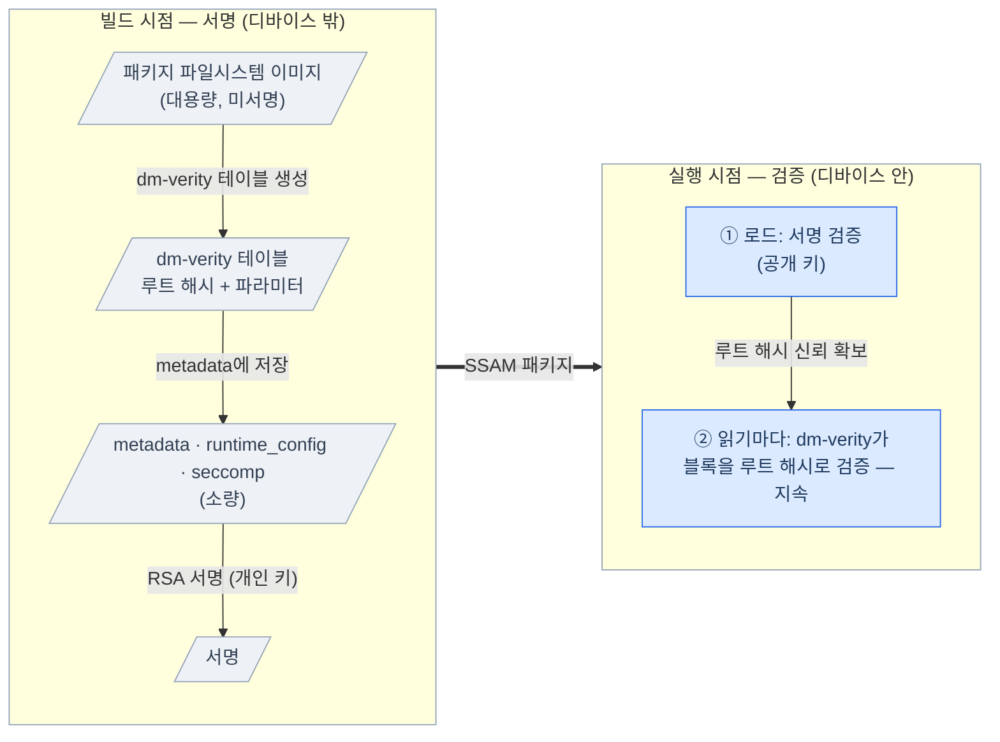

# SSAM Package Integrity

  

SSAM은 디바이스가 **신뢰할 수 있고 변조되지 않은** 패키지만 실행하도록, 그리고
패키지가 실행되는 내내 변조를 계속 감지하도록 보장합니다. 패키지는 런타임에 자유롭게
설치·업데이트되지만, 저장 위치나 가변성과 무관하게 실행 시점 무결성은 항상 검증됩니다 —
SSAM 패키지로 배포된 소프트웨어는 **자유로운 업데이트와 실행 시점 무결성을 동시에** 누립니다.
이를 세 요소 — 신뢰 앵커(trust anchor, 디바이스에 탑재되는 공개 키), *RSA* 서명,
*dm-verity* — 로 이루어진 **무결성 모델** 로 달성합니다.

---

## Table of Contents

1. [Trust model](#trust-model)
2. [Integrity chain overview](#integrity-chain-overview)
3. [Package authenticity — RSA signature](#package-authenticity--rsa-signature)
4. [Filesystem integrity — dm-verity](#filesystem-integrity--dm-verity)
5. [Hardening the package parser](#hardening-the-package-parser)
6. [Control interface security (RPC)](#control-interface-security-rpc)
7. [Threat model summary](#threat-model-summary)

---

## Trust model

신뢰의 근간은 **RSA 키 쌍** 입니다:

- **개인 키** 는 디바이스 밖, 패키지를 빌드하는 주체에게 있습니다. `ssam-wrap` 이
  패키지를 생성할 때 이 키로 각 패키지를 서명합니다.
- **공개 키** 는 디바이스에 설치되며, `ssamd` 가 신뢰하는 유일한 대상입니다. 이 키로
  검증할 수 없는 패키지는 거부됩니다.

따라서 두 가지를 보호해야 합니다:

- **개인 키의 비밀성** — 이를 가진 자는 누구든 디바이스에서 검증 가능한 패키지를 만들 수
  있습니다.
- **디바이스 내 공개 키의 무결성** — 이 공개 키가 신뢰 앵커입니다. 공격자가 이를 자신의
  서명 키로 바꿔치기하지 못하도록, 플랫폼에서 제공하는 수단(예: 읽기
  전용 파일시스템, 시큐어 부트, 파일 권한 등)으로 보호해야 합니다.

`ssamd` 자체는 **root** 로 실행되므로, 검증을 통과한 패키지는 높은 권한으로
실행됩니다 — 그래서 무엇이든 실행되기 전에 진위를 먼저 검증합니다.

---

## Integrity chain overview

SSAM은 패키지를 두 단계로 보호합니다. 로드 시 수 킬로바이트를 한 번 검사하는 데서 출발해, 패키지가
실행되는 내내 전체 파일시스템을 지속적으로 보호하는 데까지 이어집니다:

- **서명 (빌드).** `ssam-wrap` 이 **설정 데이터** 만 RSA 서명합니다 — 패키지
  파일시스템 이미지는 서명하지 않습니다.
- **검증 (로드).** `ssamd` 가 로드 시 서명을 공개 키로 확인합니다.
- **지속 검증 (런타임).** 커널의 dm-verity가 **읽기마다** 파일시스템 블록을
  검증합니다.

서명 대상은 수 킬로바이트뿐이지만, 거기에 담긴 루트 해시로 **전체 파일시스템을
간접적으로 보호합니다**.

이 분리는 **성능을 위한 의도적 선택** 입니다. 패키지 파일시스템 전체를 서명하면 로드
시점에 그 전체를 다시 검증해야 해 기동이 느려집니다. 그 대신 SSAM은 수 킬로바이트
크기의 설정 데이터에만 서명하고, 전체 파일시스템은 dm-verity에 맡겨 런타임에 필요할
때 검증합니다. 그래서 로드 시점 서명 검증이 가벼워, 빠른 컨테이너 기동을 지키면서도
실행 중 무결성까지 보장합니다.

다음 두 섹션에서 각각을 상세히 다룹니다.

---

## Package authenticity — RSA signature

각 SSAM 패키지는 **설정 데이터**(패키지를 어떻게 구성하고 실행하는지
서술하는 수 킬로바이트 분량)의 SHA-256 다이제스트에 대한 **RSA PKCS#1 v1.5
서명** 을 담습니다.

- 서명은 개인 키로 하고, `ssamd` 는 **payload를 파싱하기 전에** 공개 키로 검증하여
  패키지를 신뢰할지 판단합니다.
- 다른 키로 서명된 패키지 — 또는 서명 대상 payload가 하나라도 변경된 경우 —
  검증에 실패하고 거부됩니다.

서명 대상에서 상대적으로 대용량인 패키지 파일시스템 이미지와 서명 값 자체는 **의도적으로**
빠져 있습니다 — 파일시스템 이미지는 간접적으로 보호됩니다(다음 절).

---

## Filesystem integrity — dm-verity

패키지 파일시스템 이미지는 *dm-verity* 로 보호됩니다:

- dm-verity는 기본적으로 활성화되며 `[integrity].disable_runtime_integrity` 설정으로
  비활성화할 수 있습니다. 비활성화하면 블록 수준의 런타임 검증은 제거되지만 패키지
  서명 검증은 계속 적용됩니다.
- 서명된 `metadata` 에는 dm-verity **파라미터 전체**(루트 해시 포함)가 담깁니다.
- 로드 시점에 `ssamd` 는 그 서명된 파라미터로 dm-verity 타깃을 구성합니다.
  dm-verity의 특성상 **읽기마다 모든 블록이 검증** 되어, 변조는 로드 시점뿐
  아니라 **런타임 내내** 감지됩니다.

---

## Hardening the package parser

`ssamd` 는 서명을 검증하기 전까지 패키지 파일의 내용을 신뢰할 수 없습니다. 따라서 검증이
끝나기 **전에** 악의적 파일이 파서를 악용하지 못하도록 다음을 강제합니다:

- **검증 후 파싱 순서.** RSA 서명을 먼저 확인하고, 설정 payload는 검증이 성공한
  **후에만**, 즉 신뢰할 수 있을 때에만 로드됩니다.
- **인증 전 할당 제한.** payload 인덱스를 디코딩할 때와 검증 중 각 서명 payload를 읽을
  때 모두 크기에 고정 상한을 두어, 조작된 크기 필드로 인한 무제한 할당을
  막습니다.
- **오프셋/크기 경계 검사.** 선언된 모든 payload 영역은 읽기 전에 실제 파일
  크기와 대조되어, 범위를 벗어난 오프셋은 거부됩니다.
- **포맷 확인.** 누락/부정확한 매직이나 인식할 수 없는 포맷 버전은 payload 처리
  전에 거부됩니다.

---

## Control interface security (RPC)

- `ssamd` 는 [Remocon gRPC 제어 API](../reference/remocon-rpc.ko.md)를 포트
**63737** 에서 노출하며, [`rpc_bind_ip`](../reference/daemon-config.ko.md#rpc_bind_ip)
(기본 localhost)에 바인딩되며, TLS나 인증이 없으므로 임의의 클라이언트가 연결하여
패키지를 설치할 수 있습니다.
- 그럼에도 **누가 RPC를 호출하든 진위 검증은 여전히 강제됩니다:** 엔드포인트에 임의의
  클라이언트가 연결해 설치를 시도할 수는 있어도, 서명 검증에 실패한 패키지는 설치
  단계에서 거부되어 설정·실행되지 않습니다. 즉 서명되지 않거나 변조된 코드는 실제로
  실행될 수 없습니다.

---

## Threat model summary

이 표는 **패키지 무결성과 진위** 를 겨냥한 위협을 다룹니다. 컨테이너 수준 위협
(시스템 콜, 호스트 접근, 저장소, 네트워크)은
[Container Isolation](container-isolation.ko.md)을 보세요.

| 위협 | 주요 완화 |
| --- | --- |
| 위조 / 비신뢰 패키지 | 디바이스 내 공개 키로 RSA 서명 검증 |
| 변조된 설정 데이터 | 서명된 다이제스트에 포함 |
| 변조된 패키지 파일시스템 이미지 | 서명된 metadata 안의 dm-verity 루트 해시; 지속적 블록 검증 |
| 런타임 변조 / 패키지 파일시스템 손상 | dm-verity가 블록 장치 레벨에서 읽기마다 검증; 읽기 전용 마운트 |
| 악의적 패키지 파일(파서 DoS) | 검증 후 파싱, 디코드/크기 제한, 경계 검사 |

---

컨테이너 수준 구속(*seccomp*, *AppArmor*, 자원 제한, 네트워킹)은
[Container Isolation](container-isolation.ko.md)을, 서명과 검증의 바이트 수준
세부는 [패키지 포맷 레퍼런스](package-format.ko.md#signature-and-integrity)를
보세요.
