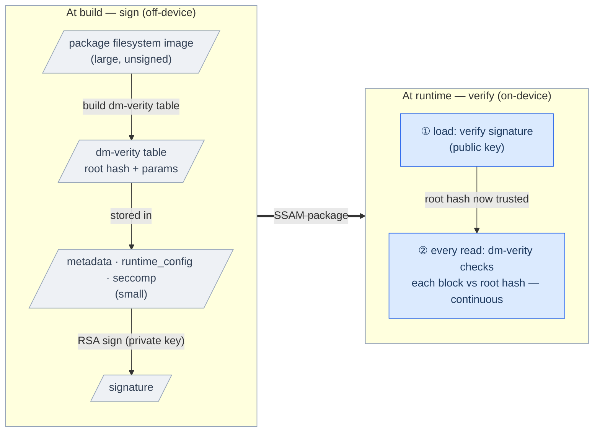
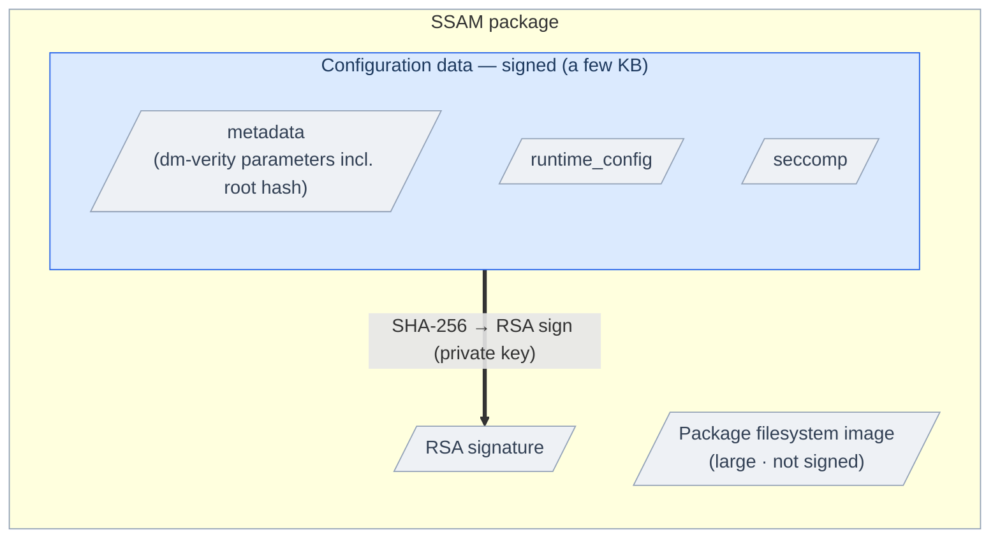
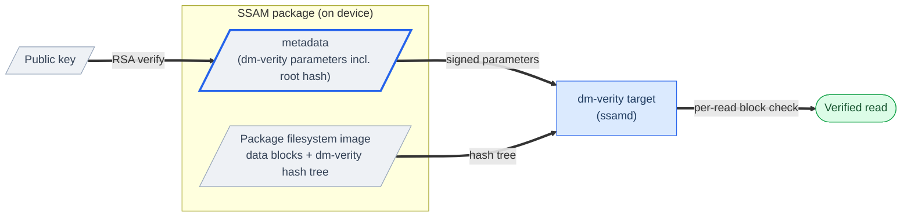

# SSAM Package Integrity

  

SSAM guarantees that a device runs **only trusted, unmodified** packages and keeps detecting tampering for as long as they run.
Packages can be installed and updated freely at runtime, yet — regardless of where they are stored or how mutable that location is — their integrity is always verified at execution time: software shipped as a SSAM package gets **free updates and run-time integrity at once**.
It does this with an **integrity model** built from three parts: a trust anchor (the on-device public key), an *RSA* signature, and *dm-verity*.

> 📖 For **how to configure** signing, *dm-verity*, and the read-only filesystem, see the [Package Integrity guide](../guides/package-integrity.md).

---

## Table of Contents

1. [Trust model](#trust-model)
2. [Integrity chain overview](#integrity-chain-overview)
3. [Package authenticity — RSA signature](#package-authenticity--rsa-signature)
4. [Filesystem integrity — dm-verity](#filesystem-integrity--dm-verity)
5. [Hardening the package parser](#hardening-the-package-parser)
6. [Control interface security (RPC)](#control-interface-security-rpc)
7. [Threat model summary](#threat-model-summary)

---

## Trust model

The root of trust is an **RSA key pair**:

- The **private key** lives off-device, with whoever builds packages; `ssam-wrap` signs each package with it at build time.
- The **public key** is installed on the device and is the only thing `ssamd` trusts.
  Any package it cannot verify against that key is rejected.

Two things must therefore be protected:

- **The private key's secrecy** — anyone holding it can produce packages the device will accept.
- **The on-device public key's integrity** — it is the trust anchor.
  If an attacker can replace it, they can substitute their own signing key, so it must be protected with the platform's normal mechanisms (read-only rootfs, secure boot, file permissions).

`ssamd` itself runs as **root**, so a package that passes verification runs with high privilege — which is exactly why authenticity is enforced before anything else runs.

---

## Integrity chain overview

SSAM protects a package in two stages.
A single few-kilobyte check at load time extends into continuous protection of the whole filesystem for as long as the package runs:

- **Sign (build).** `ssam-wrap` *RSA*-signs only the **configuration data** — the package filesystem image is not signed.
- **Verify (load).** `ssamd` verifies the signature at load with the public key.
- **Verify continuously (runtime).** The kernel's *dm-verity* checks each filesystem block **on every read**.

The signature covers only a few kilobytes but, through the embedded root hash, **transitively protects the entire filesystem**.

This split is a deliberate **performance choice**.
Signing the whole filesystem would force verifying all of it at load, slowing startup; instead SSAM signs only the few-kilobyte configuration data and leaves the filesystem to *dm-verity*, which verifies it on demand at runtime.
The load-time signature check therefore stays cheap — keeping container startup fast while still guaranteeing integrity at runtime.

The next two sections detail each half.

---

## Package authenticity — RSA signature

Each SSAM package carries an **RSA PKCS#1 v1.5 signature over a SHA-256 digest** of its **configuration data** — the few kilobytes that describe how the package is built and run.

- Signing uses the private key; `ssamd` verifies with the public key **before parsing any of those payloads**, deciding whether to trust the package.
- A package signed by a different key — or with any signed payload altered — fails verification and is refused.

The signature deliberately does **not** cover the large package filesystem image or the signature payload itself — the filesystem image is protected indirectly (next section).

---

## Filesystem integrity — dm-verity

The package filesystem image is protected by *dm-verity*.

- *dm-verity* is enabled by default and can be disabled through
  [`debug.disable_pkgfs_integrity`](../reference/daemon-config.md#disable_pkgfs_integrity).
  Disabling it removes block-level runtime verification. This setting is independent
  from package signature verification.
- [`debug.disable_package_verify`](../reference/daemon-config.md#disable_package_verify)
  defaults to `false` and is a development-only exception.
  When set to `true`, `ssamd` skips RSA signature verification and the public-key
  file check, so packages can be processed without a public key.
- The signed `metadata` contains the **entire set of dm-verity parameters** (including the root hash).
- At load time `ssamd` builds the *dm-verity* target from those signed parameters.
  By *dm-verity*'s design, **every block is verified on each read**, so tampering is detected not just at load but **continuously at runtime**.

---

## Hardening the package parser

`ssamd` cannot trust a package's contents until its signature is verified, so it bounds what a malicious file can do **before** verification completes:

- **Verify-then-parse ordering.** The *RSA* signature is checked first; the configuration payloads are deserialized and trusted **only after** verification succeeds.
- **Bounded pre-auth allocation.** Both the payload index decode and each signed payload read during verification are capped at small fixed sizes, so an attacker-controlled size field cannot force unbounded allocation.
- **Offset/size bounds checks.** Every declared payload region is validated against the actual file size before reading, rejecting out-of-range offsets.
- **Format gate.** A missing/incorrect magic or an unrecognized format version is rejected before any payload processing.

---

## Control interface security (RPC)

- `ssamd` exposes the [Remocon gRPC control API](../reference/remocon-rpc.md) over the fixed Linux abstract Unix domain socket `@ssamd`, so only processes running in the same network namespace on the same host can access it.
- An abstract socket cannot restrict access through filesystem permissions, so any process in the same network namespace that knows the name can attempt to connect.
- However, `ssamd` allows a request when one of the peer's effective or supplementary GIDs matches the daemon's effective GID or an entry in the [configured allow-list](../reference/daemon-config.md#rpc).
- **Even an installation RPC from an allowed client has package authenticity verified separately from caller authorization:** with the default verification settings, every installation request must pass signature and integrity verification, and a package that fails verification is refused and never gets set up or run. [`debug.disable_package_verify`](../reference/daemon-config.md#disable_package_verify) = `true` is a development-only exception that skips RSA signature verification.

---

## Threat model summary

This table covers the threats to **package integrity and authenticity**.
For container-level threats (syscalls, host access, storage, network), see [Container Isolation](container-isolation.md).

| Threat | Primary mitigation |
| --- | --- |
| Forged / untrusted package | RSA signature verified against on-device public key |
| Tampered configuration data | Included in the signed digest |
| Tampered package filesystem image | dm-verity parameters (incl. root hash) inside signed metadata; continuous block verification |
| Runtime tampering / corruption of the package filesystem | dm-verity verifies every block at the block-device level on read; read-only mount |
| Malicious package file (parser DoS) | Verify-then-parse, decode/size caps, bounds checks |

---

> 📖 For container-level confinement (*seccomp*, *AppArmor*, resource limits, networking), see [Container Isolation](container-isolation.md).
> For the byte-level details of signing and verification, see the [Package Format Reference](package-format.md#signature-and-integrity).
