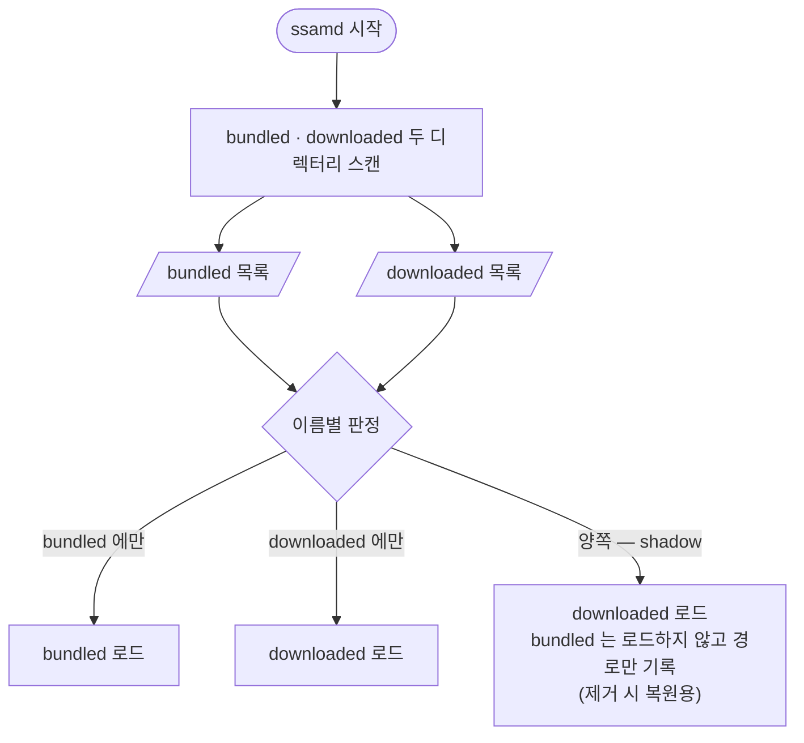
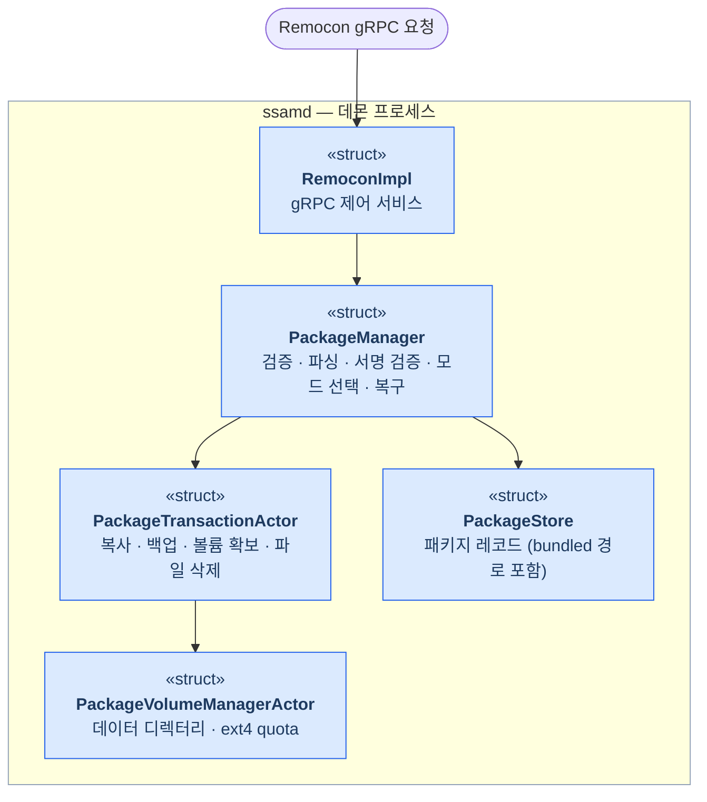

# SSAM 패키지 관리

  

`ssamd`는 디바이스에 있는 패키지 집합과 이를 바꾸는 동작 — 설치·업데이트·제거 —
을 관장합니다. 클라이언트는 이 동작을 `Remocon` *gRPC* 제어 API로 요청하고, `ssamd`는 각
요청을 내부 컴포넌트를 거쳐 수행합니다. 이 문서는 요청 처리에 관여하는 컴포넌트와 설치·업데이트·제거 흐름을 설명하고,
패키지의 저장 위치 — bundled/downloaded — 가 이 흐름을 어떻게 좌우하는지 다룹니다.

## Package sources: bundled and downloaded

`ssamd`가 관리하는 모든 패키지는 다음 두 형태 중 하나로 존재합니다:

- **Bundled** — 디바이스 이미지에 사전 탑재되는 패키지. **제거할 수 없습니다**.
- **Downloaded** — 런타임에 제어 API로 설치되는 패키지.

둘은 패키지 이름으로 이름 공간을 공유합니다. 같은 이름이면 downloaded가 bundled를
**덮어쓰고**, 그 downloaded를 제거하면 아래의 bundled 패키지가 **복원됩니다**.

두 형태는 `ssamd.toml`의 [`bundled_packages_dir`](../reference/daemon-config.ko.md#bundled_packages_dir)와
[`downloaded_packages_dir`](../reference/daemon-config.ko.md#downloaded_packages_dir)로 각각의 디렉터리를
설정해 구분합니다.
`ssamd`는 시작 시 두 디렉터리를 모두 스캔해 발견한 패키지를 전부 로드합니다.

## Components

## Installing a package

클라이언트가 [`InstallPackage`](../reference/remocon-rpc.ko.md#installpackage)로 설치를 요청하면:

1. `RemoconImpl`이 요청을 받아 `PackageManager`로 전달합니다.
2. `PackageManager`가 파일 존재와 유효성을 확인한 뒤 **파싱하고 서명을 검증**합니다.
   검증에 실패한 파일은 여기서 거부되고 저장되지 않습니다. (시작 시 경로에서는 이미
   디스크에 있는 서명 불량 파일이 대신 `Broken`으로 기록됩니다.)
3. 같은 이름의 패키지가 없으면 **신규 설치** 입니다. `PackageManager`가 준비된 설치를
   `PackageTransactionActor`에 넘기고, 이 액터가 파일을 downloaded 디렉터리로 복사한 뒤
   `PackageVolumeManagerActor`로 패키지의 볼륨 — 데이터 디렉터리와 *ext4* project
   quota — 를 확보합니다.
4. 구성된 패키지는 `PackageStore`에 저장되고 상태 머신이 시작됩니다.

## Updating a package

설치와 업데이트는 같은 `InstallPackage` 요청으로 들어옵니다 — 같은 이름의 패키지가 이미
있으면 설치는 **업데이트** 가 됩니다. `PackageManager`는 먼저
새 패키지의 버전을 기존 버전과 비교합니다 — 더 높은 버전은 업그레이드로 진행하고, 같은
버전은 거부하며, 낮은 버전은 요청이 다운그레이드를 명시할 때만 허용합니다. 이어서 기존
패키지의 위치에 따라 진행 방식을 정합니다:

- 기존이 **bundled** → bundled 베이스 위로 업그레이드,
- 기존이 **downloaded** → 기존 파일을 먼저 백업하고 downloaded 패키지를 업그레이드.

`PackageTransactionActor`는 (호출자가 초기화를 요청하면) 기존 데이터 디렉터리를 백업하고,
새 파일을 복사한 뒤 볼륨을 다시 확보합니다. 어느 단계든 실패하면 `PackageManager`가 이전
패키지를 — 파일과 데이터를 되돌려 — 복구하므로, 업데이트가 실패해도 디바이스에 동작
가능한 패키지가 없어지지 않습니다.

## Removing a package

[`RemovePackage`](../reference/remocon-rpc.ko.md#removepackage) 요청은 `PackageManager`에 도달하며:

- **bundled** 패키지는 시스템 제공이므로 제거를 **거부**하고,
- 그 외에는 패키지를 해체(중지 후 파일시스템 마운트 해제)하고, `PackageStore`에서 레코드를
  제거하며, 필요하면 볼륨을 purge하고, 파일을 삭제합니다.

제거된 패키지가 bundled를 덮어쓴 downloaded였다면, 그 자리에 **bundled 패키지가
복원됩니다**.

## Package states

설치·업데이트·제거는 패키지를 생명주기 상태 — `Verified`, `SettingUp`, `Running`,
`CleaningUp`, 그리고 종료 상태 `Broken` / `Error` — 로 전이시킵니다. 이 상태들과 패키지를
실행하는 파이프라인은 [Execution](execution.ko.md)에서 다룹니다.
