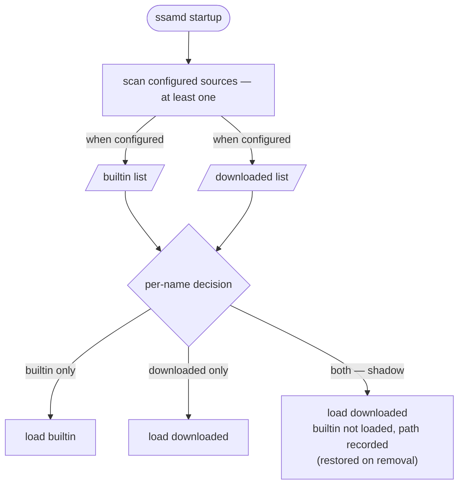
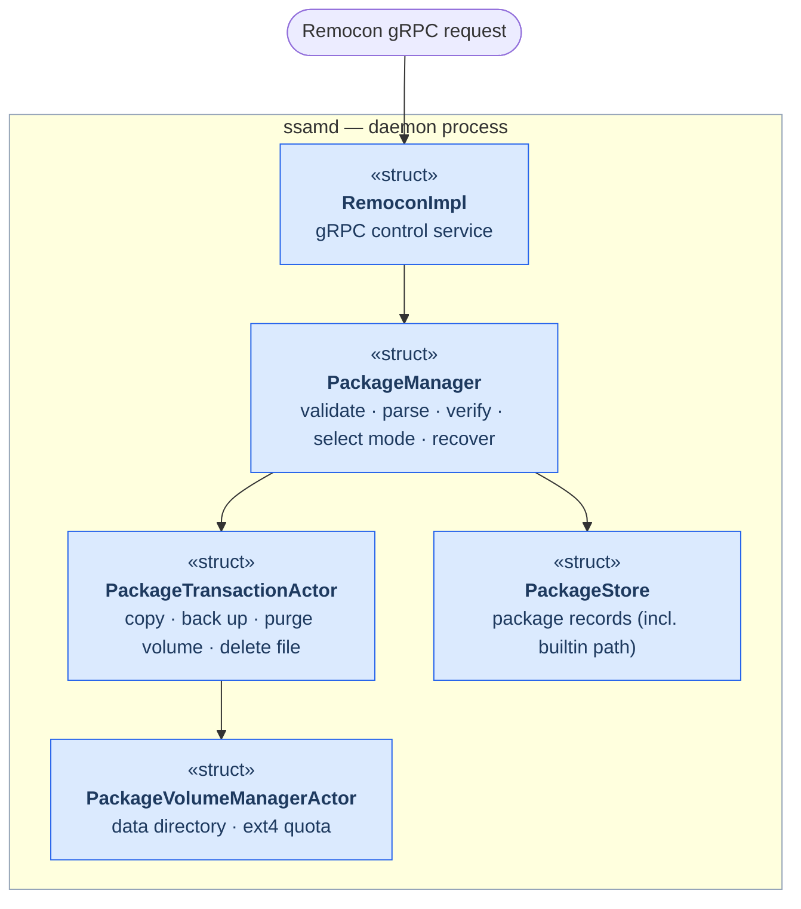

# SSAM Package Management

  

`ssamd` owns the set of packages present on a device and the operations that change it — installing, updating, and removing them.
Clients issue these over the `Remocon` *gRPC* control API, and `ssamd` carries each request through its internal components.
This document describes those components and the install / update / remove flows, and covers how a package's storage location — builtin or downloaded — shapes them.

## Package sources: builtin and downloaded

Every package `ssamd` manages exists in one of two forms:

- **Builtin** — pre-loaded in the device image.
  **Cannot be removed**.
- **Downloaded** — installed at runtime through the control API.

The two share a namespace by package name.
A downloaded package **overrides** a builtin one of the same name; removing that override **restores** the builtin package underneath.

The builtin and downloaded sources are configured by [`package.dir.builtin`](../reference/daemon-config.md#builtin) and [`package.dir.downloaded`](../reference/daemon-config.md#downloaded), respectively.
Each source is optional, but at least one source must be configured.
At startup, `ssamd` scans only the configured sources and applies the per-name precedence described below.
`InstallPackage` requires `package.dir.downloaded` to be configured; a
builtin-only deployment can load its pre-installed packages but cannot accept
runtime package installation requests.

## Components

## Installing a package

When a client issues an install via [`InstallPackage`](../reference/remocon-rpc.md#installpackage):

1. `RemoconImpl` receives the request and forwards it to `PackageManager`.
2. `PackageManager` checks the file exists and is a valid package, then parses it
   and verifies its signature when package verification is enabled.
   With the default settings, a file that fails verification is rejected here
   and never stored. `debug.disable_package_verify = true` is a development-only
   exception that skips signature verification.
   (On the startup path, an already-present file with a bad signature is instead recorded as `Broken`.)
3. With no package of that name present, this is a **fresh install**.
   `PackageManager` hands the prepared install to `PackageTransactionActor`, which copies the file into the downloaded directory.
   The package's volume — its data directory and *ext4* project quota — is only validated here and is acquired through `PackageVolumeManagerActor` when the package is set up (see [Execution](execution.md)).
4. The built package is saved in `PackageStore`, and its state machine starts.

## Updating a package

Install and update arrive as the same `InstallPackage` request: when a package of the same name already exists, the install becomes an **update**.
`PackageManager` first compares the new package's version against the installed one — a higher version proceeds as an upgrade, an equal version is rejected, and a lower version is allowed only when the request opts into a downgrade.
It then selects how to proceed from where the existing package lives:

- existing is **builtin** → upgrade over the builtin base,
- existing is **downloaded** → upgrade the downloaded package, backing up its file first.

`PackageTransactionActor` backs up the old data directory (when the caller asks to reset it) and copies the new file; the new package acquires its volume when it is set up.
If any of these steps fails, `PackageManager` recovers the previous package — restoring its file and data — so a failed update never leaves the device without a working package.
A later failure while the new package is being set up leaves it in `Error`.

## Removing a package

A [`RemovePackage`](../reference/remocon-rpc.md#removepackage) reaches `PackageManager`, which:

- **refuses** a **builtin** package — it is system-provided;
- otherwise tears the package down (stopping it and unmounting its filesystem), removes its record from `PackageStore`, optionally purges its volume, and deletes its file.

If the removed package was a downloaded override of a builtin one, the **builtin package is restored** in its place.

## Package states

Install, update, and remove move a package through its lifecycle states — `Verified`, `SettingUp`, `Running`, `CleaningUp`, and the terminal `Broken` / `Error`.
Those states and the pipeline that runs a package are covered in [Execution](execution.md).
