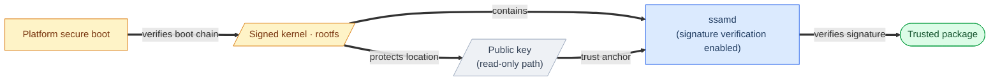

# SSAM Package Integrity

<p>
  <a href="package-integrity.ko.md"></a>
</p>

This guide covers three ways to **trust a SSAM package's contents** — that it is authentic, intact, and unchanging.
It describes how operators and package authors configure each:

- **Package signing** — only packages with valid signatures load when verification is enabled.
- **Filesystem integrity** — block tampering is caught continuously at runtime.
- **Read-only filesystem** — the filesystem itself is immutable.

> 📖 Restricting a running container's behavior (seccomp, AppArmor) is covered by the [Container Hardening](container-hardening.md) guide; network and resource isolation by the [Container Isolation](container-isolation.md) guide.

> 📖 For the design and threat model behind this integrity model, see the [Package Integrity design doc](../architecture/package-integrity.md).

---

## Table of Contents

1. [Package signing — RSA](#package-signing--rsa)
2. [Filesystem integrity — dm-verity](#filesystem-integrity--dm-verity)
3. [Read-only filesystem](#read-only-filesystem)

---

## Package signing — RSA

A SSAM package is signed with an **RSA private key** (`ssam-wrap`) and verified against the **public key** installed on the device (`ssamd`) when package signature verification is enabled.
A package that fails verification is rejected at load.

> ⚠️ [`debug.disable_package_verify`](../reference/daemon-config.md#disable_package_verify) is a development/debug-only exception.
> Its default is `false`.
> When it is `true`, `ssamd` skips RSA signature verification and the public-key file existence check.
> Packages can therefore load without a public key.
> Package format and payload structure checks still run.
> Keep this setting set to `false` in production.

> 📖 For what the signature guarantees, see [Package Integrity → Trust model](../architecture/package-integrity.md#trust-model).

### Generating the keys

`ssamd` uses a key with this spec:

- **Type** — *RSA*
- **Size** — 2048 bits or more
- **Private key format** — PKCS#8 PEM
- **Public key format** — X.509 SPKI PEM

and signs with this scheme:

- **Padding** — PKCS#1 v1.5
- **Hash** — SHA-256

For example, create them with OpenSSL:

```console
$ openssl genpkey -algorithm RSA -out private_key.pem -pkeyopt rsa_keygen_bits:2048
$ openssl rsa -in private_key.pem -pubout -out public_key.pem
```

For the default verified configuration, use the generated keys as follows:

- Use the private key (`private_key.pem`) to sign packages via `ssam-wrap --private-key`.
- Install the public key (`public_key.pem`) on the device and point the daemon config `ssamd.toml`'s [`package.public_key`](../reference/daemon-config.md#public_key) at it.

### Protecting the private key

The private key **is the signing authority** — anyone who holds it can build packages the device will verify.
Keep it in an HSM or a restricted CI secret, and **never ship it to a device**.

### Protecting the trust chain

When package signature verification is enabled, trust in a signature rests on two things — the **public key** it is checked against, and the **`ssamd` binary** that does the checking.
If either is tampered with, a forged package can pass, so protect both:

- **The public key** — the only trust anchor `ssamd` relies on.
  If an attacker swaps in their own key, forged packages pass.
- **The `ssamd` binary** — the component that performs verification.
  If it is replaced with an `ssamd` whose checks are defeated, a bad signature still passes.

When package signature verification is enabled, keep both on a **read-only, secure-boot-protected path** and minimize write access.
On platforms with secure boot, arrange that trust to extend from the boot chain through `ssamd` and the public key — the platform verifies the boot chain, that integrity protects the signed rootfs holding the `ssamd` binary and the read-only path the public key sits on, and an untampered `ssamd` uses the public key as the trust anchor to verify package signatures:



---

## Filesystem integrity — dm-verity

The package filesystem image is integrity-checked block by block with *dm-verity*.
At build time `ssam-wrap` builds the hash tree, and at runtime `ssamd` sets up the *dm-verity* target so the kernel verifies each block against that tree on every read.

> 📖 For how it works, see [Package Integrity → dm-verity](../architecture/package-integrity.md#filesystem-integrity--dm-verity).

**Kernel configuration.** *dm-verity* uses the host kernel's device-mapper verity target.
It needs these kernel options:

- `CONFIG_BLK_DEV_DM` — device-mapper
- `CONFIG_DM_VERITY` — the dm-verity target

**Operational configuration.** Block verification is on by default and needs no extra setup.
Two things are on the operator, though:

- Leave `ssamd.toml`'s [`debug.pkgfs_overlay_dir`](../reference/daemon-config.md#pkgfs_overlay_dir) **empty**.
  Setting it layers a writable overlay on top, which effectively defeats the integrity *dm-verity* guarantees — that overlay is for debugging/development, so keep it empty in production.
> ⚠️ [`debug.disable_pkgfs_integrity`](../reference/daemon-config.md#disable_pkgfs_integrity) is a **debugging-only** exception.
> Set it to `true` to skip creating the *dm-verity* target and mount the package filesystem directly from its loop device.
> The base package filesystem remains read-only, while block-level tamper detection is disabled.
> Package signature verification remains controlled independently by [`debug.disable_package_verify`](../reference/daemon-config.md#disable_package_verify).
> Keep the default (`false`) in production.

---

## Read-only filesystem

Keeping the package filesystem read-only means the rootfs cannot change at runtime, so what signing and *dm-verity* verified stays that way.
SSAM supports two filesystems:

- **EROFS (default, recommended)** — `ssam-wrap` builds it by default ([`--pkgfs-type`](../reference/ssam-wrap.md#package-filesystem-types)).
  *EROFS* is **read-only at the filesystem level**, so the mounted package filesystem has no write path at all, and it **supports compression**, shrinking image size.
  Immutable and compact, it is the default and the recommended choice.
- **ext4** — supported as an alternative.
  It is **mounted** read-only, so writes are blocked at runtime.

A read-only filesystem is a separate defense **orthogonal** to *dm-verity*: the filesystem blocks writes, and if blocks are tampered with underneath, *dm-verity* catches it — two independent defenses.

**Kernel configuration.** To mount *EROFS* images the host kernel needs:

- `CONFIG_EROFS_FS` — the EROFS filesystem
