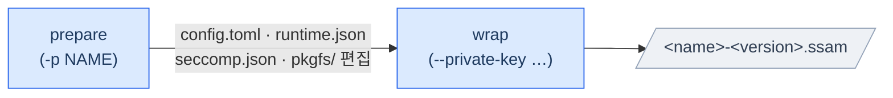

# SSAM 패키지 만들기

<p>
  <a href="wrapping-a-ssam.md"></a>
</p>

SSAM **패키지** 는 *container-native* 애플리케이션의 파일시스템·런타임 환경 구성 정보·무결성 데이터를 `ssamd`가 컨테이너로 설치·실행할 수 있는 하나의 서명된 파일에 담은 것입니다.
이 패키지는 `ssam-wrap` 도구로 생성합니다.

이 가이드는 SSAM 패키지 생성을 처음부터 끝까지 안내합니다.

> 📖 `ssam-wrap`의 모든 옵션·모드·플래그는 [`ssam-wrap` 명령어 레퍼런스](../reference/ssam-wrap.ko.md)를, 모든 패키지 설정 키는 [`config.toml` 레퍼런스 가이드](../reference/package-config.ko.md)를 참고하세요.

---

## Table of Contents

1. [The SSAM package](#the-ssam-package)
2. [Prerequisites](#prerequisites)
3. [Workflow](#workflow)
   - [At a glance](#at-a-glance)
   - [Step 1 — Prepare the workspace](#step-1--prepare-the-workspace)
   - [Step 2 — Provide the package filesystem](#step-2--provide-the-package-filesystem)
   - [Step 3 — Configure the package (`config.toml`)](#step-3--configure-the-package-configtoml)
   - [Step 4 — Configure the runtime (`runtime.json`)](#step-4--configure-the-runtime-runtimejson)
   - [Step 5 — Adjust the seccomp policy (`seccomp.json`)](#step-5--adjust-the-seccomp-policy-seccompjson)
   - [Step 6 — Confine with AppArmor (MAC)](#step-6--confine-with-apparmor-mac)
   - [Step 7 — Wrap and sign](#step-7--wrap-and-sign)
   - [Step 8 — Install and run](#step-8--install-and-run)
4. [Troubleshooting](#troubleshooting)

---

## The SSAM package

SSAM 패키지는 **워크스페이스** 에 필요한 파일을 준비한 뒤 `ssam-wrap`으로 생성합니다.
세 개의 설정 파일을 작성하고 `pkgfs/`를 채우면 됩니다(워크스페이스 구조와 파일 템플릿은 `ssam-wrap` 이 만들어 줍니다 — 이후 설명):

```
<workspace>/
├── config.toml        # 패키지 설정 (식별 정보, 보안, 서비스, 네트워크)
├── runtime.json       # OCI Runtime config (프로세스, 마운트, capability, namespace)
├── seccomp.json       # seccomp 시스템 콜 필터 정책
├── pkgfs/             # 패키지 파일시스템 — 애플리케이션의 루트 파일시스템(rootfs)
├── intermediate/      # 빌드 중간 산출물 (fs 이미지, 루트 해시) — 삭제해도 안전
└── <name>-<version>.ssam   # 최종 패키지 (기본 출력 위치)
```

`ssam-wrap`은 이를 바탕으로 다음을 구성요소로 하는 서명된 SSAM 패키지를 생성합니다:

| 구성 요소 | 생성 원천 | 목적 |
| --- | --- | --- |
| **패키지 파일시스템 이미지** | `pkgfs/` → *EROFS* 또는 *ext4* | 컨테이너가 실행되는 읽기 전용 루트 |
| **dm-verity 해시 트리 + 파라미터 테이블** | fs 이미지 | 지속적인 런타임 무결성 검증 |
| **OCI Runtime config** | `runtime.json` | 컨테이너 프로세스 실행 방식 |
| **패키지 설정** | `config.toml` | 식별 정보, 서비스 모델, 네트워크, 쿼터 |
| **seccomp 정책** | `seccomp.json` | 시스템 콜 필터링 |
| **메타데이터 + RSA 서명** | 위 전체 | 버전/빌드 정보, 변조 방지 |

> 📖 SSAM 패키지 파일의 정확한 온디스크 바이트 레이아웃(payload 인덱스, 푸터, 서명 체인)은 [SSAM 패키지 포맷 레퍼런스](../architecture/package-format.ko.md)를 참고하세요.

---

## Prerequisites

**1.
`ssam-wrap`과 도구들을 설치합니다.** 레퍼런스의 [요구 사항](../reference/ssam-wrap.ko.md#requirements)을 참고하세요.
요약하면:

```console
$ cargo install --path ssam-wrap
```

`ssam-wrap`은 여러 외부 도구를 사용합니다.
다음이 `PATH`에 있어야 합니다:

- `mkfs.erofs`
- `veritysetup`
- `fakeroot`
- `skopeo`/`umoci` (optional, OCI image 변환 기능 사용 시)

**2.
RSA 서명 키 쌍을 생성합니다.** 모든 패키지는 *RSA* 개인 키로 서명되며, `ssamd`가 대응하는 공개 키로 검증합니다.
예를 들어, 다음과 같이 생성합니다:

```console
$ mkdir -p ~/ssam/keys && cd ~/ssam/keys
$ openssl genpkey -algorithm RSA -out private_key.pem -pkeyopt rsa_keygen_bits:2048
$ openssl rsa -in private_key.pem -pubout -out public_key.pem
```

서명용으로 `private_key.pem`을 보관하고(`--private-key`), 공개 키 `public_key.pem`은 디바이스로 전달해 `ssamd`에 설정합니다(디바이스에서의 배치·보호는 [SSAM 실행하기](serving-ssam.ko.md#step-3--prepare-the-public-key)).

**개인 키는 서명 권한 그 자체입니다.** 이를 가진 누구든 디바이스가 검증할 패키지를 만들 수 있으니, HSM이나 제한된 CI 시크릿에 보관하고 절대 디바이스로 배포하지 마세요.

> 📖 서명 키 관리와 신뢰 체인은 [Package Integrity → 패키지 서명](package-integrity.ko.md#package-signing--rsa)에서 자세히 다룹니다.

---

## Workflow

### At a glance



1. **prepare** — 설정 파일을 생성합니다(필요하면 소스 파일시스템도 가져옵니다).
2. **편집** — `config.toml`, `runtime.json`, `pkgfs/`를 채웁니다.
3. **wrap** — 이미지를 빌드하고, *dm-verity* 해시 트리를 생성하고, 서명합니다.

---

### Step 1 — Prepare the workspace

prepare 모드는 워크스페이스를 생성하고 세 개의 설정 파일을 만듭니다:

```console
$ ssam-wrap --prepare myapp myapp/
```

`myapp/` 안에 다음이 생성됩니다:

- `config.toml` — `name = "myapp"`로 미리 채워짐
- `runtime.json` — 기본 *OCI Runtime config*
- `seccomp.json` — 기본 *seccomp* 정책
- `pkgfs/` — 빈 패키지 파일시스템 디렉터리(소스를 주지 않은 경우)

> prepare 모드는 기존 설정 파일을 **절대 덮어쓰지 않습니다** — 자유롭게 다시 실행해도 됩니다.

---

### Step 2 — Provide the package filesystem

`pkgfs/` 디렉터리가 컨테이너의 루트 파일시스템이 됩니다.
흔히 두 가지 방법으로 채웁니다.

**Option A — From a Docker/OCI image**

prepare 단계에서 `--pkgfs-src`로 컨테이너 소스를 지정하면, `ssam-wrap`이 이미지의 rootfs를 가져와 `pkgfs/`로 언팩합니다:

```console
$ ssam-wrap --prepare myapp \
            --pkgfs-src docker://docker.io/hello-world:latest myapp/
$ cd myapp
```

이미지가 OCI 설정을 포함하므로, `ssam-wrap`은 이를 바탕으로 `runtime.json`도 생성합니다 — SSAM에 맞게 정규화됩니다(terminal 비활성화, uid/gid 매핑 제거, user namespace 삭제).
지원되는 전체 목록은 레퍼런스의 [지원되는 컨테이너 transport](../reference/ssam-wrap.ko.md#supported-container-transports)를 참고하세요.

> 기본적으로 **arm64** 이미지 변형을 가져옵니다. x86-64 이미지의 경우 `--src-oci-arch amd64`를 추가하세요.

앱에 필요한 추가 파일은 `pkgfs/` 아래에 직접 넣습니다.
예를 들어:

```console
$ mkdir -p pkgfs/etc
$ cp /etc/resolv.conf pkgfs/etc/
```

**Option B — From scratch**

`--pkgfs-src`가 없으면 prepare 모드는 빈 `pkgfs/`를 생성하므로, 애플리케이션의 rootfs를 직접 구성합니다 — 예를 들어 정적 링크된 바이너리 한 개만으로 rootfs를 구성한다면:

```console
$ ssam-wrap --prepare myapp myapp/
$ cd myapp
$ cargo new --name helloworld app/
$ cargo build --manifest-path app/Cargo.toml \
              --target x86_64-unknown-linux-musl --release
$ cp app/target/x86_64-unknown-linux-musl/release/helloworld pkgfs/
```

> **정적 링크된** 바이너리(예: musl 타깃)를 사용하면 동적 로더와 공유 라이브러리를 `pkgfs/`에 포함할 필요가 없습니다.

> 애플리케이션에 필요한 파일 외에, 패키지 설정이나 컨테이너 실행 요건에 따라 `pkgfs/`에 추가 디렉터리 혹은 파일이 필요할 수 있습니다 — 예를 들어 `notify` 서비스는 `/run` 마운트 지점이 필요합니다(Step 4 참조).

---

### Step 3 — Configure the package (`config.toml`)

`config.toml`은 패키지의 식별 정보와 `ssamd`가 컨테이너로 실행하는 방식을 정의합니다.
최소한 이름, 설명, 유효한 [semver](https://semver.org/) 버전, 보안 태세, 서비스 타입을 설정합니다:

```toml
[package]
name = "myapp"
description = "My example application"
version = "1.0.0"

[container]

[container.security]
seccomp = true
mac = true

[service]
service_type = "simple"   # simple | exec | forking | oneshot | dbus | notify | idle
```

자주 조정하는 항목:

- **`service_type`** — *systemd* 스타일 서비스 모델.
  사용 가능한 값과 의미는 레퍼런스를 참고하세요(`notify`는 `/run` 마운트가 추가로 필요 — Step 4 참조).
- **`data_dirs`** — 컨테이너 내에서 실행되는 애플리케이션이 영속적·쓰기 가능한 저장소가 필요한 컨테이너 경로를 콜론으로 구분한 목록(기억하세요: `pkgfs/` 자체는 읽기 전용으로 사용됩니다).
- **`[container.network]`** — `host`(기본), `none`, 또는 격리된 `bridge`.
  [컨테이너 격리](container-isolation.ko.md) 참조.

> 📖 모든 키의 타입·기본값·`ssamd` 해석 방식은 **[`config.toml` 레퍼런스 가이드](../reference/package-config.ko.md)** 를 참고하세요.

---

### Step 4 — Configure the runtime (`runtime.json`)

`runtime.json`은 실행 환경 설정을 하는 표준 *OCI Runtime config* 입니다.
각 필드의 의미는 원본 스펙을 참고하세요:

- 📖 [OCI Runtime Spec — `config.md`](https://github.com/opencontainers/runtime-spec/blob/main/config.md)
- 📖 [OCI Runtime Spec — 리눅스 전용 `config-linux.md`](https://github.com/opencontainers/runtime-spec/blob/main/config-linux.md)

패키지 작성 시 주로 편집하는 부분은 다음과 같습니다:

**Point the entrypoint at your binary**

`process.args`(그리고 필요하면 `env`/`cwd`)를 애플리케이션 실행에 맞게 설정합니다:

```diff
     "args": [
-      "sh"
+      "/helloworld"
     ],
```

**Declare the mandatory mounts**

`ssam-wrap`은 런타임 설정이 SSAM이 요구하는 마운트를 선언하는지 검증하며, 그렇지 않으면 wrap을 중단합니다:

| 마운트 | 필수 조건 |
| --- | --- |
| `/dev`, `/dev/pts` | 항상 |
| `/run` | `service_type = "notify"` 일 때 추가로 |

선택적 마운트(`/proc`, `/sys`, `/tmp`)는 선언된 경우 rootfs에 생성됩니다.

**Note on Docker-derived configs**

`runtime.json`이 *Docker*/OCI 이미지에서 생성된 경우(2단계 방법 A), `ssam-wrap`은 이를 정규화합니다: `terminal` 비활성화, uid/gid 매핑 제거, user namespace 삭제.
결과를 검토하고 워크로드에 맞게 `args`/`env`를 조정하세요.

---

### Step 5 — Adjust the seccomp policy (`seccomp.json`)

`seccomp.json`은 [`container.security.seccomp`](../reference/package-config.ko.md#seccomp)이 `true` 일 때 컨테이너에 적용되는 시스템 콜 필터 정책입니다. prepare 모드가 **대부분의 패키지가 그대로 사용할 수 있는** 합리적인 기본값(*Docker* 프로파일 기반)을 생성하여 제공하지만, 필요한 경우에는 수정합니다.
`seccomp = false`로 설정하여 비활성화할 수 있으나, 디버그 목적으로만 사용하길 추천합니다.

> 📖 자세한 안내는 [Container Hardening → Seccomp](container-hardening.ko.md#system-call-filtering--seccomp)을 참고하세요.

---

### Step 6 — Confine with AppArmor (MAC)

[`container.security.mac`](../reference/package-config.ko.md#mac)을 `true`로 설정하면 컨테이너를 *AppArmor* 로 격리합니다.
프로파일은 호스트 시스템(`ssamd` 외부)에서 준비 및 로드되어 있어야 하며, 패키지의 실행 시점에 패키지별 *AppArmor* 프로파일 **`ssam-prof-<패키지명>`** 이 로드되어 있으면 `ssamd`가 이를 지정하여 실행하고, 로드돼 있지 않으면 `container-default`로 폴백합니다.
호스트 시스템에서 *AppArmor* 가 활성화돼 있지 않거나, 로드된 프로파일 목록을 읽을 수 없거나, 두 프로파일 중 어느 것도 로드돼 있지 않으면 패키지 실행에 실패합니다.

> ⚠️ `runtime.json`의 `process.apparmorProfile`에 값을 지정하더라도 `ssamd`가 위 프로파일 이름으로 덮어쓰므로 무시됩니다.

> 📖 자세한 안내는 [Container Hardening → AppArmor](container-hardening.ko.md#mandatory-access-control--apparmor)를 참고하세요.

---

### Step 7 — Wrap and sign

`pkgfs/`를 채우고 설정 파일을 편집했으면, 개인 키를 지정하여 wrap 모드를 실행합니다:

```console
$ ssam-wrap --private-key ~/ssam/keys/private_key.pem \
            --output myapp.ssam .
```

그러면 `ssam-wrap`은:

1. `pkgfs/`에서 패키지 파일시스템 이미지를 빌드하고(기본: `erofs-lz4hc` — `--pkgfs-type`으로 변경 가능),
2. `veritysetup format`을 실행하여 *dm-verity* 해시 트리를 덧붙이고 파라미터 테이블(루트 해시 포함)을 산출하며,
3. 메타데이터와 설정을 모아 패키지를 서명합니다.

성공하면 패키지 이름, 서비스 타입, 사용된 서명 키, 서명된 *dm-verity* 테이블을 출력합니다.

> 📖 모든 wrap 모드 옵션(파일시스템 타입, 출력 이름, 아키텍처)은 [명령어 레퍼런스](../reference/ssam-wrap.ko.md#command-line-reference)를 참고하세요.

---

### Step 8 — Install and run

생성된 SSAM 패키지를 `ssamd`가 실행될 호스트 시스템의 [builtin package 디렉터리](../reference/daemon-config.ko.md#builtin)로 복사한 뒤 `ssamd`를 재시작합니다:

```console
# cp myapp.ssam /var/lib/ssamd/builtin/
# systemctl restart ssamd
```

`ssam` CLI (혹은 [별도로 구현한 Remocon 클라이언트](writing-a-remocon-client.ko.md))로 상태를 관리할 수 있습니다:

```console
# ssam list          # 패키지 상태 확인
```

> 📖 `ssamd` 기동, 실행 검증, `journalctl` 로그 확인까지 포함한 완전한 예제는 [빠른 시작 가이드](../../README.ko.md#quick-start)를 참고하세요.

---

## Troubleshooting

일반적인 빌드 오류는 명령어 레퍼런스의 [문제 해결](../reference/ssam-wrap.ko.md#troubleshooting) 표에 정리되어 있습니다 — 예를 들어 `--private-key` 누락, `runtime.json`의 필수 마운트 미선언, 이전 추출로 남은 `pkgfs/` 등입니다.
