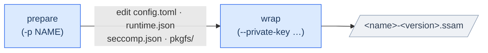

# Wrapping a SSAM

<p>
  <a href="wrapping-a-ssam.ko.md"></a>
</p>

A SSAM **package** wraps a *container-native* application's filesystem, its
runtime configuration, and its integrity data into one signed file that `ssamd`
can install and run as a container. The tool that does the wrapping is
`ssam-wrap`.

This guide walks you through creating a package end to end — from an empty
workspace to a signed SSAM package.

> 📖 For every option, mode, and flag, see the [`ssam-wrap` Command
> Reference](../reference/ssam-wrap.md); for every package-config key, the
> [`config.toml` Reference Guide](../reference/package-config.md).

---

## Table of Contents

1. [The SSAM package](#the-ssam-package)
2. [Prerequisites](#prerequisites)
3. [Workflow](#workflow)
   - [At a glance](#at-a-glance)
   - [Step 1 — Prepare the workspace](#step-1--prepare-the-workspace)
   - [Step 2 — Provide the package filesystem](#step-2--provide-the-package-filesystem)
   - [Step 3 — Configure the package (`config.toml`)](#step-3--configure-the-package-configtoml)
   - [Step 4 — Configure the runtime (`runtime.json`)](#step-4--configure-the-runtime-runtimejson)
   - [Step 5 — Adjust the seccomp policy (`seccomp.json`)](#step-5--adjust-the-seccomp-policy-seccompjson)
   - [Step 6 — Confine with AppArmor (MAC)](#step-6--confine-with-apparmor-mac)
   - [Step 7 — Wrap and sign](#step-7--wrap-and-sign)
   - [Step 8 — Install and run](#step-8--install-and-run)
4. [Troubleshooting](#troubleshooting)

---

## The SSAM package

You create a SSAM package by preparing files in a **workspace**, then running
`ssam-wrap`: you write the three config files and populate `pkgfs/` (`ssam-wrap`
scaffolds the workspace structure and file templates — described later):

```
<workspace>/
├── config.toml        # package configuration (identity, security, service, network)
├── runtime.json       # OCI Runtime config (process, mounts, capabilities, namespaces)
├── seccomp.json       # seccomp syscall-filter policy
├── pkgfs/             # the package filesystem — your application's root filesystem (rootfs)
├── intermediate/      # build intermediates (fs image, root hash) — safe to delete
└── <name>-<version>.ssam   # the final package (default output location)
```

From this workspace, `ssam-wrap` produces a single signed SSAM package with the
following components:

| Component | Produced from | Purpose |
| --- | --- | --- |
| **Package filesystem image** | `pkgfs/` → *EROFS* or *ext4* | The read-only root the container runs against |
| **dm-verity hash tree + parameter table** | the fs image | Continuous runtime integrity verification |
| **OCI Runtime config** | `runtime.json` | How the container process is launched |
| **Package config** | `config.toml` | Identity, service model, network, quotas |
| **Seccomp policy** | `seccomp.json` | Syscall filtering |
| **Metadata + RSA signature** | all of the above | Version/build info, tamper-proofing |

> 📖 For the exact on-disk byte layout of a SSAM package file (payload index, footer,
> signature chain), see the [SSAM Package Format Reference](../architecture/package-format.md).

---

## Prerequisites

**1. Install `ssam-wrap` and its tools.** See the reference's
[Requirements](../reference/ssam-wrap.md#requirements). In short:

```console
$ cargo install --path ssam-wrap
```

`ssam-wrap` uses several external tools; the following must be on `PATH`:

- `mkfs.erofs`
- `veritysetup`
- `fakeroot`
- `skopeo`/`umoci` (optional, for OCI image conversion)

**2. Generate an RSA signing key pair.** Every package is signed with an *RSA*
private key; `ssamd` verifies it with the matching public key.

```console
$ mkdir -p ~/ssam/keys && cd ~/ssam/keys
$ openssl genpkey -algorithm RSA -out private_key.pem -pkeyopt rsa_keygen_bits:2048
$ openssl rsa -in private_key.pem -pubout -out public_key.pem
```

Keep `private_key.pem` for signing (`--private-key`) and hand `public_key.pem`
to the device to configure `ssamd` (device-side placement and protection: see
[Serving SSAM](serving-ssam.md#step-3--prepare-the-public-key)).

**The private key is the signing authority itself.** Anyone holding it can
produce packages the device will verify, so keep it in an HSM or a restricted CI
secret and never ship it to devices.

> 📖 Signing-key management and the trust chain are covered in detail in [Package Integrity → Package signing](package-integrity.md#package-signing--rsa).

---

## Workflow

### At a glance



1. **Prepare** — generate the config files (and optionally pull in a source
   filesystem).
2. **Edit** — fill in `config.toml`, `runtime.json`, and `pkgfs/`.
3. **Wrap** — build the image, generate the *dm-verity* hash tree, and sign.

---

### Step 1 — Prepare the workspace

Prepare mode generates a workspace and the three config files:

```console
$ ssam-wrap --prepare myapp myapp/
```

This creates, inside `myapp/`:

- `config.toml` — pre-filled with `name = "myapp"`,
- `runtime.json` — a default *OCI Runtime config*,
- `seccomp.json` — the default *seccomp* policy,
- `pkgfs/` — an empty package filesystem directory (when no source is given).

> Prepare mode **never overwrites** existing config files — rerun it freely.

---

### Step 2 — Provide the package filesystem

The `pkgfs/` directory becomes your container's root filesystem. There are two
common ways to populate it.

**Option A — From a Docker/OCI image**

At the prepare stage, point `--pkgfs-src` at a container source; `ssam-wrap` pulls
and unpacks the image's rootfs into `pkgfs/`:

```console
$ ssam-wrap --prepare myapp \
            --pkgfs-src docker://docker.io/hello-world:latest myapp/
$ cd myapp
```

Because the image ships an OCI config, `ssam-wrap` also derives a `runtime.json`
from it — normalized for SSAM (terminal disabled, uid/gid mappings removed, user
namespace dropped). See the reference for the full list of
[supported transports](../reference/ssam-wrap.md#supported-container-transports).

> By default the **arm64** image variant is pulled. For an x86-64 image, add
> `--src-oci-arch amd64`.

Add any extra files the app needs directly under `pkgfs/`. For example:

```console
$ mkdir -p pkgfs/etc
$ cp /etc/resolv.conf pkgfs/etc/
```

**Option B — From scratch**

With no `--pkgfs-src`, prepare mode creates an empty `pkgfs/`, so you build the
application's rootfs yourself — for example, from a single statically linked binary:

```console
$ ssam-wrap --prepare myapp myapp/
$ cd myapp
$ cargo new --name helloworld app/
$ cargo build --manifest-path app/Cargo.toml \
              --target x86_64-unknown-linux-musl --release
$ cp app/target/x86_64-unknown-linux-musl/release/helloworld pkgfs/
```

> A **statically linked** binary (e.g. the musl target) avoids having to bundle
> a dynamic loader and shared libraries into `pkgfs/`.

> Beyond your application's files, the package configuration or the container's
> runtime needs may require extra directories or files in `pkgfs/` — for example, a
> `notify` service needs a `/run` mount point (see Step 4).

---

### Step 3 — Configure the package (`config.toml`)

`config.toml` defines the package's identity and how `ssamd` runs it as a
container. At
minimum, set a name, description, valid [semver](https://semver.org/) version,
security posture, and service type:

```toml
[package]
name = "myapp"
description = "My example application"
version = "1.0.0"

[container]

[container.security]
seccomp = true
mac = true

[service]
service_type = "simple"   # simple | exec | forking | oneshot | dbus | notify | idle
```

Common adjustments:

- **`service_type`** — the *systemd*-style service model. See the reference for the
  available values (`notify` additionally requires a `/run` mount — see Step 4).
- **`data_dirs`** — colon-separated container paths where the app in the container
  needs persistent, writable storage (remember: `pkgfs/` itself is used read-only).
- **`[container.network]`** — `host` (default), `none`, or an isolated
  `bridge`. See [Container Isolation](container-isolation.md).

> 📖 For every key — its type, default, and how `ssamd` interprets it — see the
> **[`config.toml` Reference Guide](../reference/package-config.md)**.

---

### Step 4 — Configure the runtime (`runtime.json`)

`runtime.json` is the standard *OCI Runtime config* that defines the container's
execution environment. Refer to the upstream spec for the meaning of every field:

- 📖 [OCI Runtime Spec — `config.md`](https://github.com/opencontainers/runtime-spec/blob/main/config.md)
- 📖 [OCI Runtime Spec — Linux-specific `config-linux.md`](https://github.com/opencontainers/runtime-spec/blob/main/config-linux.md)

When authoring a package, you'll commonly edit the following:

**Point the entrypoint at your binary**

Set `process.args` (and `env`/`cwd` as needed) to launch your application:

```diff
     "args": [
-      "sh"
+      "/helloworld"
     ],
```

**Declare the mandatory mounts**

`ssam-wrap` validates that the runtime config declares the mounts SSAM
requires, and fails the build otherwise:

| Mount | Required |
| --- | --- |
| `/dev`, `/dev/pts` | Always |
| `/run` | Additionally, when `service_type = "notify"` |

Optional mounts (`/proc`, `/sys`, `/tmp`) are created in the rootfs when
declared.

**Note on Docker-derived configs**

When `runtime.json` is generated from a *Docker*/OCI image (Step 2, Option A),
`ssam-wrap` normalizes it: `terminal` is disabled, uid/gid mappings are
removed, and the user namespace is dropped. Review the result and adjust
`args`/`env` for your workload.

---

### Step 5 — Adjust the seccomp policy (`seccomp.json`)

`seccomp.json` is the container's syscall-filter policy, applied when
[`container.security.seccomp`](../reference/package-config.md#seccomp) is `true`. Prepare mode provides a sensible default
(*Docker*'s profile) that **most packages use as-is**, editing it only when needed.
You can disable filtering by setting `seccomp = false`, but that is recommended
for debugging only.

> 📖 For full guidance, see [Container Hardening → Seccomp](container-hardening.md#system-call-filtering--seccomp).

---

### Step 6 — Confine with AppArmor (MAC)

Set [`container.security.mac`](../reference/package-config.md#mac) to `true` to confine the container with *AppArmor*.
Profiles must be prepared and loaded on the host (outside `ssamd`); at runtime, if
the per-package *AppArmor* profile **`ssam-prof-<package-name>`** is loaded, `ssamd`
selects it, falling back to `container-default` if it is not loaded.

> ⚠️ Even if you set `process.apparmorProfile` in `runtime.json`, `ssamd`
> overwrites it with the profile name above, so it is ignored.

> 📖 For full guidance, see [Container Hardening → AppArmor](container-hardening.md#mandatory-access-control--apparmor).

---

### Step 7 — Wrap and sign

With `pkgfs/` populated and the config files edited, run wrap mode by supplying
a private key:

```console
$ ssam-wrap --private-key ~/ssam/keys/private_key.pem \
            --output myapp.ssam .
```

`ssam-wrap` then:

1. builds the package filesystem image from `pkgfs/` (default:
   `erofs-lz4hc` — override with `--pkgfs-type`),
2. runs `veritysetup format` to append a *dm-verity* hash tree and produce the
   *dm-verity* parameter table (including the root hash),
3. assembles the metadata and configs, and signs the package.

On success it prints the package name, service type, the signing key used, and
the signed *dm-verity* table.

> 📖 For all wrap-mode options (filesystem types, output naming, architecture), see the [command reference](../reference/ssam-wrap.md#command-line-reference).

---

### Step 8 — Install and run

Copy the resulting SSAM package into the [bundled-packages directory](../reference/daemon-config.md#bundled_packages_dir) on the host where `ssamd` runs, then restart `ssamd`:

```console
# cp myapp.ssam /var/lib/ssamd/bundled/
# systemctl restart ssamd
```

You can then manage its state with the `ssam` CLI (or [a Remocon client you implement](writing-a-remocon-client.md)):

```console
# ssam list          # see package status
```

> 📖 For a complete end-to-end example — starting `ssamd`, verifying execution, and inspecting logs with `journalctl` — see the [Quick-start Guide](../../README.md#quick-start).

---

## Troubleshooting

Common build errors are listed in the command reference's
[Troubleshooting](../reference/ssam-wrap.md#troubleshooting) table — for example, a missing
`--private-key`, an undeclared mandatory mount in `runtime.json`, or a leftover
`pkgfs/` from a previous extraction.
